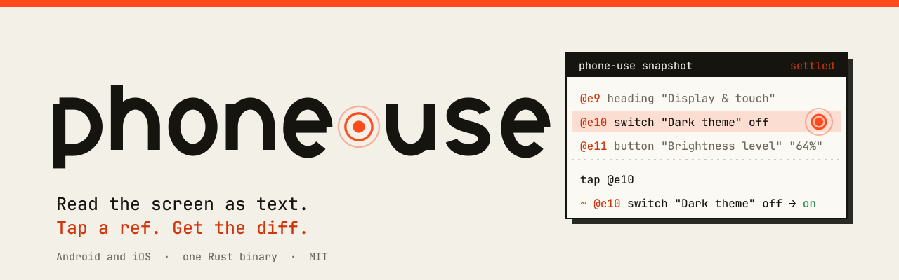
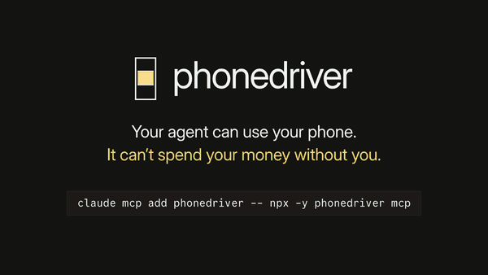
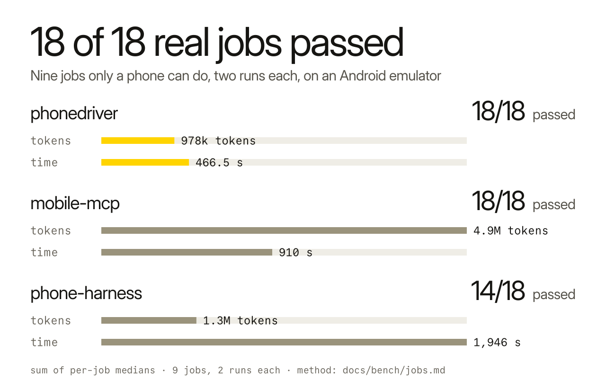
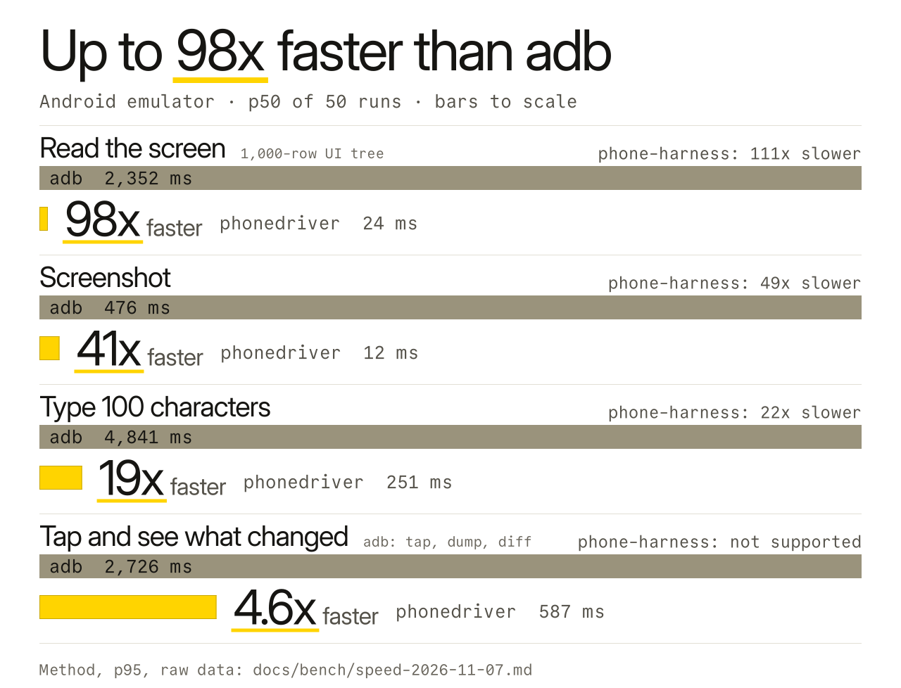
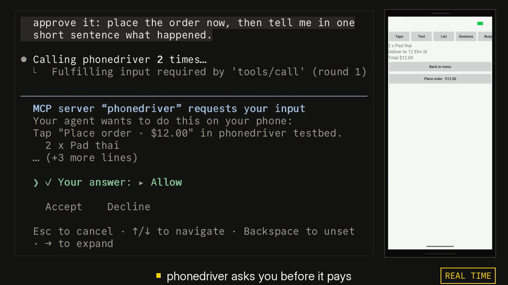

<p align="center"><picture><source media="(prefers-color-scheme: dark)" srcset=".github/assets/banner-dark.svg"></picture></p>

<h3 align="center">AI エージェントにスマートフォンを持たせます。</h3>

<p align="center"><b>同じ作業で、mobile-mcp が使ったトークンは 6.9 倍でした。</b></p>

<p align="center">
  <a href="LICENSE"></a>
  <a href="https://www.npmjs.com/package/phonedriver"></a>
  <a href="https://github.com/hridaya423/phonedriver/actions/workflows/ci.yml"></a>
</p>

<p align="center">
  <a href="https://phonedriver.dev">phonedriver.dev</a> · <a href="docs/reference.md">Reference</a> · <a href="docs/bench/jobs.md">Benchmarks</a> · <a href="https://github.com/hridaya423/phonedriver/releases">Releases</a>
</p>

<p align="center"><a href="README.md">English</a> · <a href="README.zh-CN.md">简体中文</a> · <a href="README.ja.md">日本語</a> · <a href="README.ko.md">한국어</a></p>

> このドキュメントは機械翻訳です。内容は[英語版 README](README.md) を正とします。誤訳を見つけたら issue や PR で教えてください。

phonedriver は、Claude Code、Codex、Cursor、その他あらゆる MCP クライアントから、Android スマートフォンや iPhone を使えるようにします。画面をテキストとして読み取り、Pay をタップする前にあなたに確認します。6.9 倍は、[9 つのスマートフォン作業](#少ないトークン)のトークン合計の比です。

<p align="center">
  
</p>

<p align="center"><sub>Android エミュレーター上の、実際の Claude Code（Opus 5.5）セッションで、dominos.co.uk で注文しています。動画は承認プロンプトから始まり、その後、最初から実行の様子を見せます。実行には 6.5 分かかり、15x で表示しています。承認プロンプトは実時間で再生します。何も注文されていません。<a href=".github/assets/demo.mp4">フル動画（MP4）</a>。</sub></p>

## 始め方

```sh
claude mcp add phonedriver -- npx -y phonedriver mcp
```

または、Homebrew でバイナリをインストールして、それを登録します。

```sh
brew install hridaya423/tap/phonedriver
claude mcp add phonedriver -- phonedriver mcp
```

または、プラグインとしてインストールします。サーバーとその [skill](SKILL.md) が一緒に追加されます。プラグインと `mcp add` はどちらか一方だけを使ってください。両方使うと、ツールが 2 回表示されます。

```sh
claude plugin marketplace add hridaya423/phonedriver && claude plugin install phonedriver@phonedriver   # Claude Code
codex plugin marketplace add hridaya423/phonedriver && codex plugin add phonedriver@phonedriver         # Codex
```

<a href="https://cursor.com/en/install-mcp?name=phonedriver&config=eyJjb21tYW5kIjoibnB4IiwiYXJncyI6WyIteSIsInBob25lZHJpdmVyIiwibWNwIl19"></a> <a href="https://insiders.vscode.dev/redirect/mcp/install?name=phonedriver&config=%7B%22command%22%3A%22npx%22%2C%22args%22%3A%5B%22-y%22%2C%22phonedriver%22%2C%22mcp%22%5D%7D"></a>

<p>         </p>

phonedriver は stdio 上の標準的な MCP サーバーです。そのため、どの MCP クライアントからでも実行できます。私は Claude Code でテストしています。他のクライアントの設定は [他のクライアント](#他のクライアント) をご覧ください。

Android エミュレーターを起動するか、USB デバッグを有効にした Android スマートフォンを接続するか、iOS シミュレーターを起動します。そのうえで、スマートフォンでしかできない作業を Claude に頼みます。

> Order me a large pepperoni pizza from the Domino's nearest Leicester Square, for collection.

> Open my app, sign up with a new account, and tell me every bug you find on the way. Give me steps to reproduce each one.

> Go through my app's onboarding in dark mode and in light mode, and show me every screen where the text is hard to read.

1 つ目は上のデモです。phonedriver は Buy with GPay で止まり、あなたに確認します。

初回の実行では、お使いのマシン（macOS、Linux、Windows）向けのバイナリを 1 つダウンロードし、キャッシュします。`phonedriver doctor` は adb、Xcode、各デバイスを調べ、直すべき点を教えてくれます。シェルと PowerShell のインストーラーと実機の iPhone については [docs/reference.md](docs/reference.md#install) をご覧ください。

## 少ないトークン

トークンは、エージェントの利用上限を消費する単位です。Claude Sonnet 5.5 と 3 つの MCP サーバーで、スマートフォンでしかできない 9 つの作業を、それぞれ 2 回ずつ実行しました。作業には、Chrome の検索エンジンの設定、写真のトリミング、Messages のスレッドのピン留めとアーカイブ、スマートフォンをスリープさせないアプリの特定、仕込んだバグを探すサインアップフローのテストが含まれます。実行後は、モデルの報告ではなく、スクリプトがスマートフォン自身のデータを確認しました。

<p align="center"><picture><source media="(prefers-color-scheme: dark)" srcset=".github/assets/jobs-dark.svg"></picture></p>

これは私自身のテストセットです。3 つのツールはすべて、2026 年 11 月 10 日に同じ Android エミュレーター上で実行しました。すべての実行、バージョン、チェック内容、除外したデータは [docs/bench/jobs.md](docs/bench/jobs.md) で公開しています。これらのツールのどれかをメンテナンスしていて、設定が間違っていると思う場合は、issue を立ててください。再実行します。

## モデルに見えるもの

画面はそれぞれ、番号付きの短いリストとして届きます。これは Android エミュレーター上の Settings アプリです。

```console
$ phonedriver snapshot
app com.android.settings (Settings) · keyboard hidden · settled in 0ms
@e1 button "Search Settings"
@e2 group scrollable↓
  @e3 button "Google" "Services & preferences"
  @e4 button "Network & internet" "Mobile, Wi‑Fi, hotspot"
  @e5 button "Connected devices" "Bluetooth, pairing"
  ...
  @e10 button "Display & touch" "Dark theme, font size, touch"
```

モデルは番号でタップします。phonedriver は画面の変化が止まるまで待ってから返答します。`tap @e10` の後、Display 画面が開き、返答にはその内容が `@e24 switch "Dark theme" off` を含めて並びます。次のタップでは、変化した部分だけが返ります。

```console
$ phonedriver tap @e24
ok tapped @e24 "Dark theme" at 353,532 · settled in 2034ms
~ @e23 button "Dark theme" "Will turn on when Bedtime starts" → "Will never turn off automatically"
~ @e24 switch "Dark theme" off → on
```

`+` は新しく現れた行、`-` は消えた行、`~` は変化した行を表します。モデルはポーリングする必要も、画面の読み込みにかかる時間を推測する必要もありません。画像を見る必要があるときにだけ、スクリーンショットを撮ります。

## 速度

<p align="center">
  <picture><source media="(prefers-color-scheme: dark)" srcset=".github/assets/hero-dark.svg"></picture>
</p>

2026 年 11 月 11 日に、Android 17 エミュレーター上で phonedriver 0.1.1 を使い、50 回の実行の中央値を `adb shell uiautomator dump`、`screencap`、`input` と比較して測定しました。差は、phonedriver がスマートフォン上で起動する小さなヘルパープロセスから生まれます。ヘルパーはアクセシビリティ接続を開いたままにします。adb は毎回、新しいプロセスを起動して XML を書き出します。HONOR X8（Android 13）では、画面の読み取りが 78.5 ms 対 2,507 ms、スクリーンショットが 16 ms 対 1,006 ms でした。[方法と生データ。](docs/bench/speed.md)

## 支払う前に確認する

ラベルが Pay、Buy now、Buy with GPay、Place order、Start subscription、Transfer、Delete account のいずれかのボタンをタップしようとすると、phonedriver はそのタップを保留し、Claude Code 自身のプロンプトであなたに確認します。モデルにはこの質問は見えず、答えることもできません。このようなプロンプトを表示できないクライアントでは、タップは待機し、モデルがチャットであなたに確認する必要があります。

<p align="center"></p>

Allow、Allow for this session、Decline から選びます。確認なしでエージェントを実行したい場合は、その旨をエージェントへの指示に書くと、エージェントは `autonomous: true` を渡します。`PHONEDRIVER_GUARD=off` でこのチェックを無効にすることもできます。

このチェックは、英語、スペイン語、ポルトガル語、フランス語、ドイツ語、イタリア語、オランダ語、日本語、中国語（簡体字）、韓国語、ヒンディー語のボタンラベルを読み取ります。アイコンだけの支払いボタンや、それ以外の言語のラベルのボタンは検出できません。デフォルトでは、支払いとアカウントの削除について確認します。さらに多くの操作で確認したい場合は、`PHONEDRIVER_ASK` に `send`（Send、Reply、Post、Share）、`delete`（Delete、Remove、Clear all）、`install`（Install、Uninstall）のいずれかを設定します。例: `PHONEDRIVER_ASK=send,delete`。プロンプトには、どの種類のタップかが表示されます。

モデルは、パスワード欄やワンタイムコード欄にプレーンテキストを入力できません。`secret` を使うよう伝えるエラーが返ります。`secret` を使うと、テキストはログやトレースに残りません。

## 対応デバイス

| スマートフォン | 必要なもの |
|---|---|
| Android エミュレーター | adb |
| Android スマートフォンまたはタブレット | adb と USB デバッグ |
| iOS シミュレーター | Xcode を入れた Mac |
| iPhone または iPad | Xcode を入れた Mac と Apple Development 証明書（[セットアップ](docs/reference.md#iphone-or-ipad)） |

Android にはインストールするアプリはありません。phonedriver は接続時に、adb でヘルパーをプッシュします。iOS では、Mac 上で小さな XCTest ランナーをビルドします。実機の iPhone では、接続して `phonedriver ios setup` を実行します。証明書から署名チームを読み取り、スマートフォンを確認し、ランナーをビルド、インストール、起動するので、チーム ID を調べる必要はありません。

セットアップ後は、ケーブルを外せます。iPhone では、`phonedriver ios wifi on` を実行してからケーブルを抜きます。Mac と同じ Wi-Fi ネットワークにある間は、`phonedriver devices` に表示され続けます。Android スマートフォンでは、`phonedriver pair` または `phonedriver untether` で同じことができます（[Android over Wi-Fi](docs/reference.md#android-over-wi-fi)）。スマートフォンが遠くにある場合、たとえばトンネルやモバイルネットワーク経由のときは、phonedriver は小さめの画面ストリームと圧縮した画面ツリーを送ります。3G に制限した回線では、エミュレーターでのタップの中央値は 1.4 s で、以前は 2.8 s でした。

Android 13 以降では、エージェントは非表示の 2 つ目の画面で作業できます。そのため、あなた自身の画面はそのまま使えます。MCP 設定で `PHONEDRIVER_DISPLAY=hidden` を設定するか、CLI に `--display hidden` を渡します。エミュレーターと HONOR X8（Android 13）でテストしています。アプリ自身の入力欄への入力は、あなたの画面に何も残しません。Web ページへの入力では、システムのクリップボードの通知が表示され、その後クリップボードは元に戻されます。

MCP サーバーには 14 個のツールがあります: `devices`, `apps`, `snapshot`, `screenshot`, `tap`, `type`, `swipe`, `scroll`, `press`, `launch`, `wait`, `batch`, `clipboard`, `shell`。`snapshot`、`screenshot`、`wait` は読み取り専用としてマークされているため、クライアントは権限プロンプトなしで実行できます。`phonedriver` CLI にも同じコマンドがあり、スクリプトや、シェルを好むエージェントで使えます。ターミナルで使ったデバイスは、30 秒間アイドルになるとエージェントに引き渡されます。

1 回の呼び出しで、パス全体をタップできます: `tap {"target":"More options","then":["Settings","Dark theme"]}`。モデルは、指示されない限り 1 ステップずつタップします。そこで、エージェントにスキル（`phonedriver skill` で表示されます）を渡してください。スキルは、パスを送るようエージェントに伝えます。

## 制限事項

Android エミュレーター（API 26 と 37）、HONOR X8（Android 13）、iOS シミュレーター、iPhone 13 Pro Max、iPhone 14 Plus、iPad Pro でテストしています。他の Android スマートフォンも同じ経路を使います。それらからのバグ報告を歓迎します。
タップだけなら、Android エミュレーターでは 29〜39 ms、実機の iPhone では 450〜530 ms かかります。「速度」のグラフの 514 ms は、タップ、画面の変化が止まるまでの待機、変化した内容のリストを合わせたものです。
モデルは、あなたが指でできることなら、スマートフォン上で何でもできます。無人での実行には、エミュレーターか予備のスマートフォンを使ってください。
phonedriver はパスコードを入力せず、Face ID や指紋認証を通ることもできません。ロックされたスマートフォンでは、コマンドが停止し、デバイスがロックされていると伝えます。`main` では、エージェントが使っている間、phonedriver は iPhone をスリープさせません。0.1.3 では、長いタスクの前に Auto-Lock を Never に設定してください。銀行系アプリなど、スクリーンショットをブロックする画面は、スクリーンショットでは黒くなりますが、テキストは読み取れます。

## 他のクライアント

```sh
claude mcp add phonedriver -- npx -y phonedriver mcp     # Claude Code
codex mcp add phonedriver -- npx -y phonedriver mcp      # Codex
code --add-mcp '{"name":"phonedriver","command":"npx","args":["-y","phonedriver","mcp"]}'   # VS Code
```

他のクライアントはすべて、MCP 設定ファイルに同じエントリーを書きます。

```json
{
  "mcpServers": {
    "phonedriver": { "command": "npx", "args": ["-y", "phonedriver", "mcp"] }
  }
}
```

複数のデバイスを接続している場合は、`"env": { "PHONEDRIVER_DEVICE": "android:emulator-5554" }` を追加します。`phonedriver devices` で ID を一覧できます。

## 仕組み

Android では、phonedriver は adb 経由でスマートフォン上に小さな Java ヘルパーを起動します。ヘルパーは UiAutomation でアクセシビリティツリーを読み取り、画面を H.264 動画としてストリーミングします。これにより、phonedriver は画面の変化が止まったことを知ります。iOS では、XCTest ランナーが同じ役割を果たします。コンピューターで動くデーモンが接続を開いたままにし、どの `@e` 番号がどの要素かを記憶しているため、リストが動いた後でもタップは正しい位置に届きます。MCP サーバーと CLI は、そのデーモンの薄いクライアントです。

phonedriver はテレメトリーを送信しません。GitHub からの最初のダウンロードの後は、お使いのデバイスにしか接続しません。また、他のすべての接続をブロックするサンドボックスでツール全体を実行するテストがあります。設計ノート: [architecture](docs/architecture.md)、[protocol](docs/protocol.md)、[decisions](docs/decisions.md)。

## よくある質問

**Claude に Android スマートフォンを操作させるには?** `claude mcp add phonedriver -- npx -y phonedriver mcp` を実行し、USB デバッグを有効にして、スマートフォンを接続します。

**iPhone でも動きますか?** はい。Xcode を入れた Mac から、シミュレーターでも、iPhone や iPad でも動きます。`phonedriver ios setup` が Apple developer team でランナーに署名し、`phonedriver ios wifi on` でケーブルを抜けます。

**エージェントはこれで買い物ができますか?** あなたの返答なしにはできません。ただし、自律的に実行するよう指示した場合は除きます。[支払う前に確認する](#支払う前に確認する) をご覧ください。

**仕事で使えますか?** はい。AGPL-3.0 なので、自由に使えます。変更して、ネットワークサービスとして他の人に提供する場合は、変更を公開する必要があります。

## ライセンス

AGPL-3.0-only。[LICENSE](LICENSE) をご覧ください。Android ヘルパーには、Apache-2.0 の scrcpy のファイルが含まれます。[NOTICE](NOTICE) をご覧ください。

このバイナリは、ソースからビルドした OpenH264 で H.264 をデコードします。Cisco の特許ライセンスは Cisco が配布するバイナリのみを対象とするため、このビルドには H.264 の特許ライセンスは含まれません。
