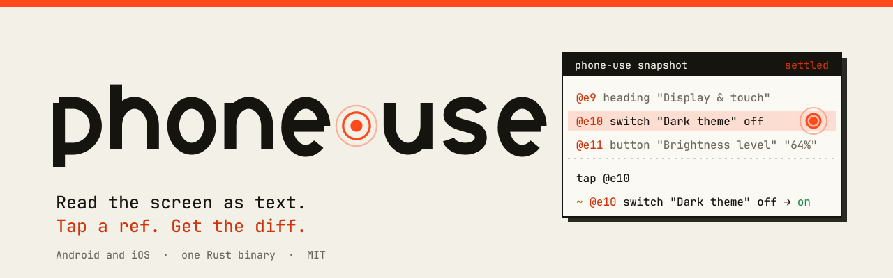
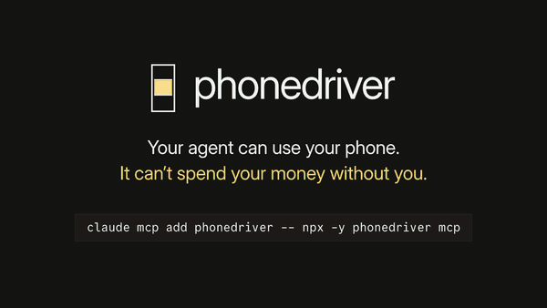
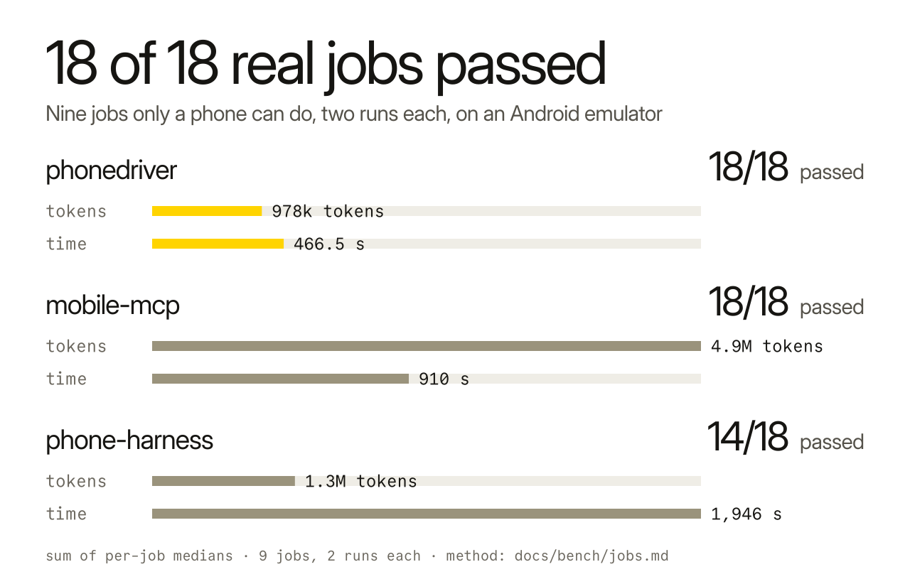
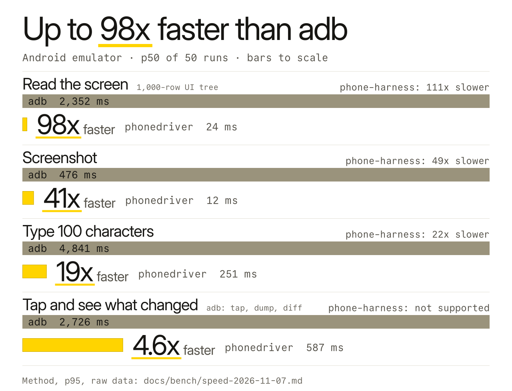
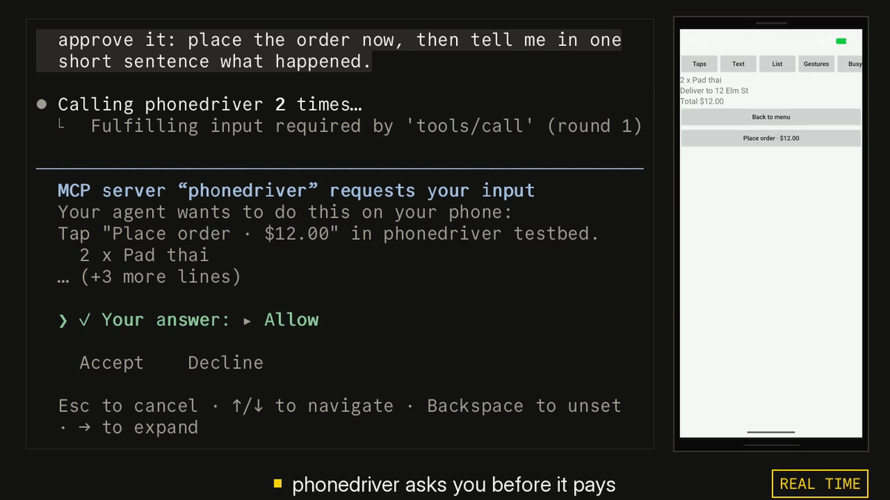

<p align="center"><picture><source media="(prefers-color-scheme: dark)" srcset=".github/assets/banner-dark.svg"></picture></p>

<h3 align="center">AI 에이전트에게 스마트폰을 줍니다.</h3>

<p align="center"><b>같은 작업에서 mobile-mcp는 토큰을 6.9배 더 사용했습니다.</b></p>

<p align="center">
  <a href="LICENSE"></a>
  <a href="https://www.npmjs.com/package/phonedriver"></a>
  <a href="https://github.com/hridaya423/phonedriver/actions/workflows/ci.yml"></a>
</p>

<p align="center">
  <a href="https://phonedriver.dev">phonedriver.dev</a> · <a href="docs/reference.md">Reference</a> · <a href="docs/bench/jobs.md">Benchmarks</a> · <a href="https://github.com/hridaya423/phonedriver/releases">Releases</a>
</p>

<p align="center"><a href="README.md">English</a> · <a href="README.zh-CN.md">简体中文</a> · <a href="README.ja.md">日本語</a> · <a href="README.ko.md">한국어</a></p>

> 이 문서는 기계 번역입니다. 내용은 [영문 README](README.md)를 기준으로 합니다. 번역 오류를 발견하면 issue나 PR로 알려 주세요.

phonedriver를 사용하면 Claude Code, Codex, Cursor 등 모든 MCP 클라이언트가 Android 스마트폰이나 iPhone을 사용할 수 있습니다. 화면을 텍스트로 읽고, Pay를 탭하기 전에 사용자에게 먼저 묻습니다. 6.9배는 [스마트폰 작업 9개](#더-적은-토큰)의 토큰 합계 비교입니다.

<p align="center">
  
</p>

<p align="center"><sub>실제 Claude Code(Opus 5.5) 세션 하나를 Android 에뮬레이터에서 실행해 dominos.co.uk에서 주문하는 모습입니다. 영상은 승인 프롬프트에서 시작하고, 이어서 처음부터 실행 과정을 보여 줍니다. 실행에는 6.5분이 걸렸고 15x로 재생합니다. 승인 프롬프트는 실제 속도로 재생합니다. 아무것도 주문되지 않았습니다. <a href=".github/assets/demo.mp4">전체 영상(MP4)</a>.</sub></p>

## 시작하기

```sh
claude mcp add phonedriver -- npx -y phonedriver mcp
```

또는 Homebrew로 바이너리를 설치한 뒤 그것을 등록합니다.

```sh
brew install hridaya423/tap/phonedriver
claude mcp add phonedriver -- phonedriver mcp
```

또는 플러그인으로 설치합니다. 서버와 그 [skill](SKILL.md)이 함께 추가됩니다. 플러그인과 `mcp add` 중 하나만 사용하세요. 둘 다 사용하면 도구가 두 번 표시됩니다.

```sh
claude plugin marketplace add hridaya423/phonedriver && claude plugin install phonedriver@phonedriver   # Claude Code
codex plugin marketplace add hridaya423/phonedriver && codex plugin add phonedriver@phonedriver         # Codex
```

<a href="https://cursor.com/en/install-mcp?name=phonedriver&config=eyJjb21tYW5kIjoibnB4IiwiYXJncyI6WyIteSIsInBob25lZHJpdmVyIiwibWNwIl19"></a> <a href="https://insiders.vscode.dev/redirect/mcp/install?name=phonedriver&config=%7B%22command%22%3A%22npx%22%2C%22args%22%3A%5B%22-y%22%2C%22phonedriver%22%2C%22mcp%22%5D%7D"></a>

<p>         </p>

phonedriver는 stdio 기반의 표준 MCP 서버이므로 어떤 MCP 클라이언트에서도 실행할 수 있습니다. 저는 Claude Code로 테스트합니다. 다른 클라이언트의 설정은 [다른 클라이언트](#다른-클라이언트)를 참고하세요.

Android 에뮬레이터를 실행하거나, USB 디버깅을 켠 Android 스마트폰을 연결하거나, iOS 시뮬레이터를 부팅하세요. 그런 다음 Claude에게 스마트폰으로만 할 수 있는 작업을 맡기세요.

> Order me a large pepperoni pizza from the Domino's nearest Leicester Square, for collection.

> Open my app, sign up with a new account, and tell me every bug you find on the way. Give me steps to reproduce each one.

> Go through my app's onboarding in dark mode and in light mode, and show me every screen where the text is hard to read.

첫 번째는 위의 데모입니다. phonedriver는 Buy with GPay에서 멈추고 사용자에게 묻습니다.

처음 실행할 때 사용 중인 컴퓨터(macOS, Linux, Windows)에 맞는 바이너리 하나를 내려받아 캐시합니다. `phonedriver doctor`는 adb, Xcode, 각 기기를 점검하고 무엇을 고쳐야 하는지 알려 줍니다. 셸과 PowerShell 설치 스크립트, 그리고 실제 iPhone은 [docs/reference.md](docs/reference.md#install)를 참고하세요.

## 더 적은 토큰

토큰은 에이전트의 사용량 한도를 소모하는 단위입니다. Claude Sonnet 5.5와 MCP 서버 3개로, 스마트폰으로만 할 수 있는 작업 9개를 각각 두 번씩 실행했습니다. 작업에는 Chrome의 검색 엔진 설정, 사진 자르기, Messages 스레드 고정과 보관, 스마트폰이 꺼지지 않게 만드는 앱 찾기, 심어 둔 버그를 찾는 가입 흐름 테스트가 포함되었습니다. 실행 후에는 모델의 보고가 아니라 스크립트가 스마트폰 자체의 데이터를 확인했습니다.

<p align="center"><picture><source media="(prefers-color-scheme: dark)" srcset=".github/assets/jobs-dark.svg"></picture></p>

이것은 제가 직접 만든 테스트 세트입니다. 세 도구 모두 2026년 11월 10일에 같은 Android 에뮬레이터에서 실행했습니다. 모든 실행, 버전, 검사 내용, 제외한 데이터는 [docs/bench/jobs.md](docs/bench/jobs.md)에 공개되어 있습니다. 이 도구 중 하나를 관리하고 있고 제가 설정을 잘못했다고 생각하신다면 issue를 열어 주세요. 다시 실행하겠습니다.

## 모델이 보는 것

화면은 하나하나 짧은 번호 목록으로 전달됩니다. Android 에뮬레이터의 Settings 앱입니다.

```console
$ phonedriver snapshot
app com.android.settings (Settings) · keyboard hidden · settled in 0ms
@e1 button "Search Settings"
@e2 group scrollable↓
  @e3 button "Google" "Services & preferences"
  @e4 button "Network & internet" "Mobile, Wi‑Fi, hotspot"
  @e5 button "Connected devices" "Bluetooth, pairing"
  ...
  @e10 button "Display & touch" "Dark theme, font size, touch"
```

모델은 번호로 탭합니다. phonedriver는 화면 변화가 멈출 때까지 기다린 뒤 응답합니다. `tap @e10` 후에 Display 화면이 열리고, 응답에는 `@e24 switch "Dark theme" off`를 포함해 그 화면의 내용이 나열됩니다. 다음 탭에서는 바뀐 부분만 돌아옵니다.

```console
$ phonedriver tap @e24
ok tapped @e24 "Dark theme" at 353,532 · settled in 2034ms
~ @e23 button "Dark theme" "Will turn on when Bedtime starts" → "Will never turn off automatically"
~ @e24 switch "Dark theme" off → on
```

`+`는 새로 나타난 줄, `-`는 사라진 줄, `~`는 바뀐 줄을 나타냅니다. 모델은 폴링하거나 화면이 로드되는 데 걸리는 시간을 추측할 필요가 없습니다. 이미지를 봐야 할 때만 스크린샷을 찍습니다.

## 속도

<p align="center">
  <picture><source media="(prefers-color-scheme: dark)" srcset=".github/assets/hero-dark.svg"></picture>
</p>

2026년 11월 11일에 Android 17 에뮬레이터에서 phonedriver 0.1.1로, 50회 실행의 중앙값을 `adb shell uiautomator dump`, `screencap`, `input`과 비교해 측정했습니다. 차이는 phonedriver가 스마트폰에서 실행하는 작은 헬퍼 프로세스에서 생깁니다. 헬퍼는 접근성 연결을 계속 열어 둡니다. adb는 매번 새 프로세스를 시작하고 XML을 씁니다. HONOR X8(Android 13)에서는 화면 읽기가 78.5 ms 대 2,507 ms, 스크린샷이 16 ms 대 1,006 ms였습니다. [방법과 원본 데이터.](docs/bench/speed.md)

## 결제 전에 확인하기

탭이 Pay, Buy now, Buy with GPay, Place order, Start subscription, Transfer, Delete account 라벨이 붙은 버튼에 닿으면 phonedriver는 그 탭을 보류하고 Claude Code 자체 프롬프트로 사용자에게 묻습니다. 모델은 이 질문을 볼 수 없고 답할 수도 없습니다. 이런 프롬프트를 표시할 수 없는 클라이언트에서는 탭이 대기하고, 모델이 채팅에서 사용자에게 물어야 합니다.

<p align="center"></p>

Allow, Allow for this session, Decline 중에서 선택합니다. 에이전트가 묻지 않고 실행되게 하려면 에이전트의 지시문에 그렇게 적으면 되고, 에이전트는 `autonomous: true`를 전달합니다. `PHONEDRIVER_GUARD=off`로 이 검사를 끌 수도 있습니다.

이 검사는 영어, 스페인어, 포르투갈어, 프랑스어, 독일어, 이탈리아어, 네덜란드어, 일본어, 중국어(간체), 한국어, 힌디어로 된 버튼 라벨을 읽습니다. 아이콘만 있는 결제 버튼이나 다른 언어로 라벨이 붙은 버튼은 잡아내지 못합니다. 기본적으로는 결제와 계정 삭제에 대해 묻습니다. 더 많은 동작에 대해 묻게 하려면 `PHONEDRIVER_ASK`를 `send`(Send, Reply, Post, Share), `delete`(Delete, Remove, Clear all), `install`(Install, Uninstall) 중 원하는 값으로 설정하세요. 예: `PHONEDRIVER_ASK=send,delete`. 프롬프트에는 어떤 종류의 탭인지 표시됩니다.

모델은 비밀번호 필드나 일회용 코드 필드에 일반 텍스트를 입력할 수 없습니다. `secret`을 사용하라는 오류를 받습니다. `secret`을 쓰면 텍스트가 로그와 트레이스에 남지 않습니다.

## 지원 기기

| 스마트폰 | 필요한 것 |
|---|---|
| Android 에뮬레이터 | adb |
| Android 스마트폰 또는 태블릿 | adb와 USB 디버깅 |
| iOS 시뮬레이터 | Xcode가 설치된 Mac |
| iPhone 또는 iPad | Xcode가 설치된 Mac과 Apple Development 인증서([설정](docs/reference.md#iphone-or-ipad)) |

Android에서는 설치할 앱이 없습니다. phonedriver는 연결할 때 adb로 헬퍼를 푸시합니다. iOS에서는 Mac에서 작은 XCTest 러너를 빌드합니다. 실제 iPhone은 연결한 뒤 `phonedriver ios setup`을 실행합니다. 인증서에서 서명 팀을 읽고, 스마트폰을 점검하고, 러너를 빌드, 설치, 시작하므로 팀 ID를 찾아볼 필요가 없습니다.

설정이 끝나면 케이블을 뺄 수 있습니다. iPhone은 `phonedriver ios wifi on`을 실행한 뒤 케이블을 뽑습니다. Mac과 같은 Wi-Fi 네트워크에 있는 동안은 `phonedriver devices`에 계속 표시됩니다. Android 스마트폰은 `phonedriver pair` 또는 `phonedriver untether`로 같은 일을 할 수 있습니다([Android over Wi-Fi](docs/reference.md#android-over-wi-fi)). 스마트폰이 멀리 있을 때, 예를 들어 터널이나 모바일 네트워크를 쓸 때는 phonedriver가 더 작은 화면 스트림과 압축한 화면 트리를 보냅니다. 3G로 제한한 링크에서 에뮬레이터의 탭 중앙값은 1.4 s였고, 이전에는 2.8 s였습니다.

Android 13 이상에서는 에이전트가 숨겨진 두 번째 화면에서 작업할 수 있으므로, 사용자의 화면은 그대로 사용자의 것으로 남습니다. MCP 설정에서 `PHONEDRIVER_DISPLAY=hidden`을 설정하거나 CLI에 `--display hidden`을 전달하세요. 에뮬레이터와 HONOR X8(Android 13)에서 테스트했습니다. 앱 자체 입력란에 입력하면 사용자의 화면에 아무 흔적도 남지 않습니다. 웹 페이지에 입력하면 시스템의 클립보드 안내가 표시되고, 이후 클립보드는 원래대로 복원됩니다.

MCP 서버에는 도구가 14개 있습니다. `devices`, `apps`, `snapshot`, `screenshot`, `tap`, `type`, `swipe`, `scroll`, `press`, `launch`, `wait`, `batch`, `clipboard`, `shell`입니다. `snapshot`, `screenshot`, `wait`는 읽기 전용으로 표시되어 있으므로 클라이언트는 권한 프롬프트 없이 실행할 수 있습니다. `phonedriver` CLI에도 같은 명령이 있어, 스크립트나 셸을 선호하는 에이전트에서 쓸 수 있습니다. 터미널에서 사용한 기기는 30초 동안 유휴 상태이면 에이전트에게 넘어갑니다.

한 번의 호출로 경로 전체를 탭할 수 있습니다. `tap {"target":"More options","then":["Settings","Dark theme"]}`. 모델은 따로 지시하지 않으면 한 단계씩 탭합니다. 그러니 에이전트에게 스킬(`phonedriver skill`로 출력됩니다)을 주세요. 스킬은 경로를 보내라고 에이전트에게 알려 줍니다.

## 제한 사항

Android 에뮬레이터(API 26과 37), HONOR X8(Android 13), iOS 시뮬레이터, iPhone 13 Pro Max, iPhone 14 Plus, iPad Pro에서 테스트했습니다. 다른 Android 스마트폰도 같은 경로를 사용합니다. 그런 기기에서의 버그 리포트를 환영합니다.
탭 하나만 놓고 보면 Android 에뮬레이터에서는 29~39 ms, 실제 iPhone에서는 450~530 ms가 걸립니다. 속도 차트의 514 ms는 탭, 화면 변화가 멈출 때까지의 대기, 바뀐 내용의 목록을 합친 값입니다.
모델은 사용자가 손가락으로 할 수 있는 모든 일을 스마트폰에서 할 수 있습니다. 사람이 지켜보지 않는 실행에는 에뮬레이터나 여분의 스마트폰을 사용하세요.
phonedriver는 패스코드를 입력하지 않으며 Face ID나 지문 확인을 통과할 수 없습니다. 잠긴 스마트폰에서는 명령이 멈추고 기기가 잠겨 있다고 알려 줍니다. `main`에서는 에이전트가 사용하는 동안 phonedriver가 iPhone이 잠들지 않게 합니다. 0.1.3에서는 긴 작업 전에 Auto-Lock을 Never로 설정하세요. 일부 은행 앱처럼 스크린샷을 막는 화면은 스크린샷에서 검게 나오지만, 텍스트는 여전히 읽을 수 있습니다.

## 다른 클라이언트

```sh
claude mcp add phonedriver -- npx -y phonedriver mcp     # Claude Code
codex mcp add phonedriver -- npx -y phonedriver mcp      # Codex
code --add-mcp '{"name":"phonedriver","command":"npx","args":["-y","phonedriver","mcp"]}'   # VS Code
```

그 밖의 모든 클라이언트는 MCP 설정 파일에 같은 항목을 넣습니다.

```json
{
  "mcpServers": {
    "phonedriver": { "command": "npx", "args": ["-y", "phonedriver", "mcp"] }
  }
}
```

기기가 둘 이상 연결되어 있으면 `"env": { "PHONEDRIVER_DEVICE": "android:emulator-5554" }`를 추가하세요. `phonedriver devices`로 id 목록을 볼 수 있습니다.

## 작동 방식

Android에서 phonedriver는 adb로 스마트폰에서 작은 Java 헬퍼를 시작합니다. 헬퍼는 UiAutomation으로 접근성 트리를 읽고 화면을 H.264 영상으로 스트리밍하며, phonedriver는 이를 통해 화면 변화가 멈춘 것을 알 수 있습니다. iOS에서는 XCTest 러너가 같은 역할을 합니다. 컴퓨터의 데몬이 연결을 계속 열어 두고 어떤 `@e` 번호가 어떤 요소인지 기억하므로, 목록이 움직인 뒤에도 탭이 정확한 위치에 닿습니다. MCP 서버와 CLI는 그 데몬의 얇은 클라이언트입니다.

phonedriver는 텔레메트리를 전송하지 않습니다. GitHub에서 처음 내려받은 뒤에는 사용자의 기기에만 연결하며, 다른 모든 연결을 차단하는 샌드박스에서 도구 전체를 실행하는 테스트가 있습니다. 설계 노트: [architecture](docs/architecture.md), [protocol](docs/protocol.md), [decisions](docs/decisions.md).

## 자주 묻는 질문

**Claude가 내 Android 스마트폰을 제어하게 하려면 어떻게 하나요?** `claude mcp add phonedriver -- npx -y phonedriver mcp`를 실행하고, USB 디버깅을 켠 뒤, 스마트폰을 연결하세요.

**iPhone에서도 작동하나요?** 네. Xcode가 설치된 Mac에서 시뮬레이터나 iPhone, iPad로 사용할 수 있습니다. `phonedriver ios setup`은 Apple developer team으로 러너에 서명하고, `phonedriver ios wifi on`을 쓰면 케이블을 뺄 수 있습니다.

**에이전트가 이것으로 물건을 살 수 있나요?** 사용자의 답이 없으면 살 수 없습니다. 자율적으로 실행하라고 지시한 경우는 예외입니다. [결제 전에 확인하기](#결제-전에-확인하기)를 참고하세요.

**회사에서 사용해도 되나요?** 네. AGPL-3.0이므로 자유롭게 사용할 수 있습니다. 수정한 것을 네트워크 서비스로 다른 사람에게 제공한다면 변경 사항을 공개해야 합니다.

## 라이선스

AGPL-3.0-only. [LICENSE](LICENSE)를 참고하세요. Android 헬퍼에는 Apache-2.0 라이선스의 scrcpy 파일이 포함되어 있습니다. [NOTICE](NOTICE)를 참고하세요.

바이너리는 소스에서 빌드한 OpenH264로 H.264를 디코딩합니다. Cisco의 특허 라이선스는 Cisco가 배포하는 바이너리에만 적용되므로, 이 빌드에는 H.264 특허 라이선스가 없습니다.
