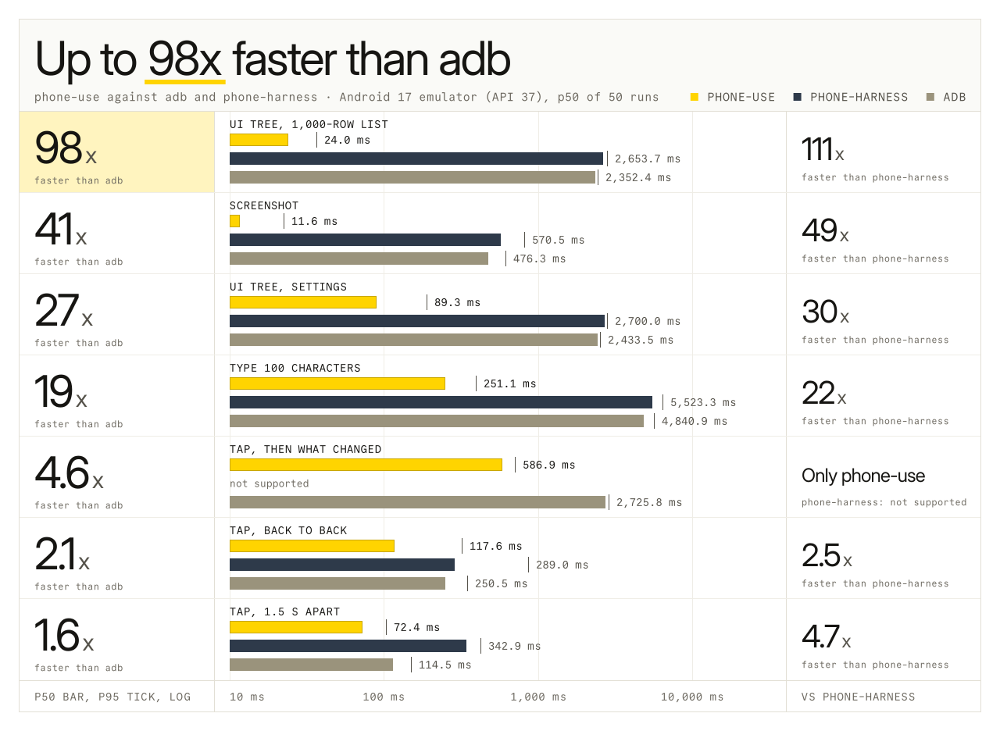
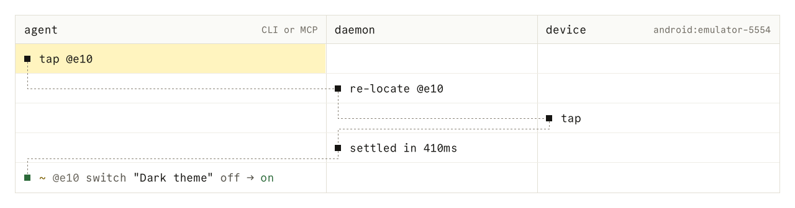
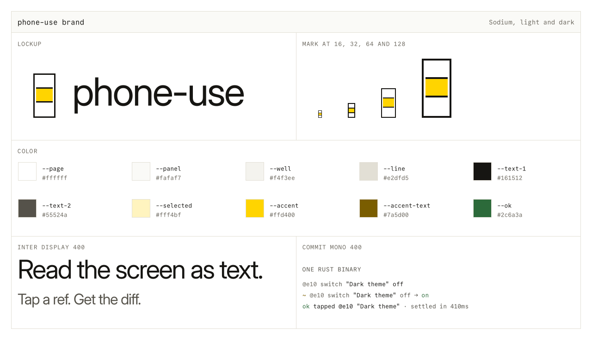

<p align="center">
  <picture>
    <source media="(prefers-color-scheme: dark)" srcset=".github/assets/banner-dark.svg">
    
  </picture>
</p>

<p align="center">
  <a href="LICENSE"></a>
  
</p>

phone-use gives an AI agent a text view of an Android or iOS screen and the means to tap, type and swipe. Every action returns only the lines that changed.

<p align="center">
  
</p>

<sub>A real recording, not a re-rendering: Claude Code's own terminal UI (captured with VHS) running Sonnet 5.5 on a subscription, driving the iOS 26.5 Simulator through the phone-use MCP server, next to the Simulator's own screen video. The two are aligned by wall-clock start times and played at real speed, cut only at the start and end of the run (nothing trimmed between tool calls); 15 s from prompt to answer. The prompt is `Open Safari, go to example.com and tell me what the page says.` Two of its calls failed (`launch url` was rejected as malformed; `launch app` needed a `--device` because two Simulators were booted) and the agent recovered by itself. Safari already had example.com loaded from an earlier run. The first frame is the finished state; an <a href=".github/assets/demo.mp4">MP4</a> is at higher quality. Recorded by `design/build/demo_record.py` and `demo_compose.py`.</sub>

## Speed

<p align="center">
  <picture>
    <source media="(prefers-color-scheme: dark)" srcset=".github/assets/speed-dark.svg">
    
  </picture>
</p>

phone-use against plain `adb` and phone-harness 0.3.3 on an Android 17 emulator (API 37, headless, software rendering) on win-pc, median of 50 runs after 5 warm-ups. phone-use and adb were measured back to back on a busy machine with the same method ([`docs/bench/adb.md`](docs/bench/adb.md)); each phone-use figure is the slower of two runs. The phone-harness bars are the quieter-machine run of [`docs/bench/m1.md`](docs/bench/m1.md), run in process, so they favor phone-harness. `adb` returns raw XML and a tap that returns before the app reacts; phone-use returns a pruned tree and the settled diff, so "tap, then what changed" for adb is a tap, a `uiautomator dump` and a diff in the caller.

> [!NOTE]
> On that busy machine a bare tap took 130 to 144 ms, against 30 to 37 ms on the quieter M1 run, so phone-harness's M1 tap (110.7 ms) is below it. Tap misses its 15 ms budget in both (D14). Typing 100 characters misses its 150 ms budget (755 ms here, 253 to 288 ms in M1). On the iOS 26.5 Simulator, tap is 357 ms against 80 ms, because XCTest takes about 240 ms to confirm the event (D15). On an iPhone 14 Plus and an iPad Pro (M5), tap is 534 and 454 ms. No physical Android phone has been measured.

<details>
<summary>All figures</summary>

| Operation | phone-use | adb | phone-harness (M1) |
|---|---|---|---|
| tap | 144.1 ms | 223.7 ms | 110.7 ms |
| screenshot | 45.3 ms | 692.4 ms | 390.1 ms |
| UI tree, Settings | 237.0 ms | 2800.5 ms | 2426.4 ms |
| UI tree, 1,000-row list | 52.8 ms | 2677.9 ms | 2370.0 ms |
| type 100 characters | 755.0 ms | 5204.4 ms | 2104.5 ms |
| tap, then what changed | 666.9 ms | 3111.7 ms | not supported |

`adb input text` and phone-harness cannot type Unicode; phone-use typed mixed-script text in the typing row, adb and phone-harness ASCII.

</details>

## Try it

1. Install phone-use first (see [Install](#install)), then add it to Claude Code as an MCP server. Use the binary's full path.

   ```sh
   claude mcp add phone-use -- "$(pwd)/target/release/phone-use" mcp
   claude mcp list    # expect: phone-use ... Connected
   ```

   For the first run, boot one simulator or connect one device, so no `--device` or `PHONE_USE_DEVICE` is needed. `phone-use skill` prints the instructions an agent reads; the MCP server also carries a short version.

2. Boot a simulator or connect a device, then ask the agent.

   > Open Settings and turn on dark mode.

3. The agent calls the tools, for example `launch`, `swipe` and `tap`. Each reply is plain text. The tap that turns the switch on returns this (iOS Simulator):

   ```console
   ok tapped @e41 "Dark Appearance" at 337,198 · settled in 607ms
   - @e65 @e66 @e67
   ~ @e41 switch "Dark Appearance" off → on
   + @e68 button "L4S"
   ```

   `+`, `-` and `~` mark lines that appeared, left and changed. The agent does not poll or sleep: every action waits for the screen to settle.

## Install

After the first release (nothing is published yet, so these do not work today), one line installs the prebuilt binary. Each artifact has the Android agent inside.

```sh
# macOS and Linux
curl --proto '=https' --tlsv1.2 -LsSf https://github.com/hridaya423/phone-use/releases/latest/download/phone-use-installer.sh | sh

# Homebrew (macOS and Linux)
brew install hridaya423/tap/phone-use
```

```powershell
# Windows
powershell -ExecutionPolicy Bypass -c "irm https://github.com/hridaya423/phone-use/releases/latest/download/phone-use-installer.ps1 | iex"
```

The shell and PowerShell installers put `phone-use` in `$CARGO_HOME/bin` (`~/.cargo/bin`) and add it to your `PATH`. The iOS Simulator runner needs no download: its sources are inside the binary, and the first command that needs it builds it on your Mac with Xcode and XcodeGen.

To build from source instead, use Rust 1.99 or later.

```sh
cargo build --release
```

The build packs the Android agent, so it needs the Android SDK with build-tools **37.0.0** and platform **android-37.0** (`ANDROID_HOME`, falling back to `ANDROID_SDK_ROOT`, then `/opt/homebrew/share/android-commandlinetools`), `d8` and JDK 17. Override the versions with `ANDROID_BUILD_TOOLS` and `ANDROID_PLATFORM`. If anything is missing the build says exactly what and how to get it. To skip that step, set `PHONE_USE_AGENT_JAR` to a built `phone-use-agent.jar` (`bash android-agent/build.sh` makes one; none is published yet).

**iOS only, no Android toolchain:**

```sh
cargo build --release -p phone-use --no-default-features
```

That binary has no Android support (`phone-use doctor` skips the Android checks). Run the tests with the default features. The binary is `target/release/phone-use`.

```console
$ target/release/phone-use version
phone-use 0.1.0
```

Run `phone-use doctor`. It checks adb, each Android device, the agent, UiAutomation, the video stream, Xcode, the simulators, and the permissions of the daemon socket. Each line says `ok`, `warn` or `fail`, and a fix follows every line that is not `ok`.

```console
$ phone-use doctor
ok    adb server       0029 at 127.0.0.1:5037
warn  android devices  none connected
      fix: Connect a phone with USB debugging on, or start an emulator; `adb devices` lists what adb sees.
ok    xcode            Xcode 27.0, Build version 27A266a
ok    xcodegen         /opt/homebrew/bin/xcodegen
warn  simulators       none booted
      fix: Boot one in Simulator.app or with `xcrun simctl boot <udid>`; `xcrun simctl list devices available` lists them.
ok    daemon socket    /Users/you/.phone-use/run/daemon.sock mode 600 in a directory of mode 700
```

The CLI runs the same loop. `phone-use skill` prints [`SKILL.md`](SKILL.md), the instructions an agent reads before it uses the tools.

```sh
phone-use devices
phone-use snapshot
phone-use tap "Dark theme"
phone-use wait settled
```

### iPhone or iPad

A physical iOS device needs the runner signed with your Apple developer team (a free Apple ID works and expires every 7 days). Plug the device in, unlock it, then:

```sh
phone-use ios setup                  # pairing, Developer Mode, developer disk image
export PHONE_USE_TEAM=<your team ID>   # Xcode > Settings > Accounts, or: security find-identity -v -p codesigning
phone-use --device ios:<udid> snapshot
```

Without a team, the command stops with exit code 3 and says so. With a booted Simulator and an iPhone that has no team, the Simulator is the default device. The daemon reads `PHONE_USE_TEAM` when it starts, so run `phone-use daemon stop` after setting it.

## Environment variables

| Name | Default | Meaning |
|---|---|---|
| `PHONE_USE_HOME` | `~/.phone-use` | Where the daemon keeps its socket (`run/`), `daemon.log`, `traces/`, `tmp/` and the iOS `runner/` builds. Set it to run a separate daemon. On macOS the socket path must stay under about 100 bytes. |
| `PHONE_USE_SOCKET` | under `PHONE_USE_HOME` (else `$XDG_RUNTIME_DIR/phone-use`) | The daemon's socket or named pipe. Point it at an `ssh -L` forward to use a remote machine's devices. |
| `PHONE_USE_DEVICE` | none | The device to use when `--device` is not given. Also read by `phone-use mcp`. |
| `PHONE_USE_SESSION` | `default` | The session name, as `--session`. |
| `PHONE_USE_TEAM` | none | Apple developer team ID that signs the iOS runner on a physical device. |
| `PHONE_USE_IOS_TIER` | `runner` | `coredevice` selects the CoreDevice tier on iOS 27 devices. Experimental. |
| `PHONE_USE_SECRET` | none | The text for `type --secret`, instead of stdin. |
| `PHONE_USE_TRACE_FULL` | off | `1` keeps observation text and text targets in traces (the daemon reads it at start). |
| `PHONE_USE_TRACE_SCREENS` | off | `1` copies every screenshot next to its trace file. |
| `PHONE_USE_AGENT_JAR` | built by `android-agent/build.sh` | Build time only: use this prebuilt Android agent jar. |
| `ADB_SERVER_SOCKET` | `tcp:127.0.0.1:5037` | The adb server to use, for example a tunnel to another machine. |
| `PHONE_USE_TEST_DEVICE`, `PHONE_USE_TEST_IOS_UDID`, `PHONE_USE_BENCH`, `PHONE_USE_BIN` | none | Tests and benchmarks only. |

The runner's own `PHONE_USE_PORT`, `PHONE_USE_BUILD` and `PHONE_USE_UDID` are set by phone-use for the iOS runner and are not for you.

## Debugging

When something does not work:

- `phone-use doctor` checks the toolchain, devices and the socket, and says how to fix each problem.
- `$PHONE_USE_HOME/daemon.log` (default `~/.phone-use/daemon.log`) holds the daemon's own messages and startup errors.
- `$PHONE_USE_HOME/traces/<id>.jsonl` has one line per request: method, parameters, the reply's summary, `ms` and settle time. Typed text is recorded only as a length. Start the daemon with `PHONE_USE_TRACE_FULL=1` to keep observation text, and `PHONE_USE_TRACE_SCREENS=1` to keep screenshots. A running daemon keeps its options: `phone-use daemon stop` first.
- iOS: `$PHONE_USE_HOME/runner/<udid>.log` is the runner's output, and `runner/<hash>/build.log` is its first build.
- `phone-use daemon stop` stops the daemon and the iOS runners it started. The next command starts a new one.

Exit codes: `0` done, `1` the command failed, `2` the command line is wrong, `3` a person must act on the device (unlock, trust, allow), `4` no matching device or it was disconnected. On a terminal, a first command that takes more than a second says what it is doing (building the runner, starting the agent).

## Supported devices

| Device | Status | Needs |
|---|---|---|
| Android emulator, API 26 and 37 | Tested. The 21-scenario suite passes on both (M2, `docs/bench/m2.md`). | adb |
| Android phone or tablet | Built on the same path. Not tested on hardware. | adb, USB debugging on |
| iOS Simulator (iOS 26.5) | Tested. The 12-scenario suite passes (M4, `docs/bench/m4.md`). One flake in `settings-dark-appearance` is unexplained. | A Mac with Xcode 27 and XcodeGen |
| iPhone or iPad (Runner tier) | Tested on an iPhone 14 Plus (iOS 26.1) and an iPad Pro (iOS 27.0) through the CLI and MCP (M5, `docs/bench/m5.md`). Screenshot, snapshot and the settled tap diff are within budget. A tap misses its 80 ms budget (454 to 534 ms at p50). The 12-scenario suite was not run on devices. | A Mac with Xcode and a signing team (`PHONE_USE_TEAM`) |

The iOS Simulator tier builds and runs a small XCTest runner. Android needs no install on the phone: the daemon pushes and starts its agent.

## How it works

<p align="center">
  <picture>
    <source media="(prefers-color-scheme: dark)" srcset=".github/assets/loop-dark.svg">
    
  </picture>
</p>

The CLI and the MCP server are thin clients. A daemon keeps the device connection open, so each call costs milliseconds. The daemon owns the ref table and the settle logic. Refs such as `@e10` are re-located when the tap happens, so a list that shifted by a row still gets the right tap. Design notes: [`docs/architecture.md`](docs/architecture.md), [`docs/protocol.md`](docs/protocol.md), [`docs/decisions.md`](docs/decisions.md).

A snapshot lists the screen as text. This is the Android Settings app, cut to eight lines.

```console
$ phone-use snapshot
device android:emulator-5554 · Pixel 9 · Android 17 · 360x800pt · portrait
app com.android.settings (Settings) · keyboard hidden · settled in 212ms
@e1 button "Search Settings"
@e2 group scrollable↓
  @e3 button "Google" "Services & preferences"
  @e4 button "Network & internet" "Mobile, Wi‑Fi, hotspot"
  @e5 button "Connected devices" "Bluetooth, pairing"
  @e6 button "Apps" "Assistant, recent apps, default apps"
```

A tap returns the lines that changed instead of the whole screen.

```console
$ phone-use tap @e10
ok tapped @e10 "Dark theme" · settled in 410ms
~ @e10 switch "Dark theme" off → on
```

### Use a device on another machine

The daemon listens on a Unix socket and nowhere else. To drive a simulator or phone that is plugged into another machine, forward that socket over `ssh` and point the CLI at the local end:

```sh
ssh -N -L /tmp/phone-use-mini.sock:/Users/you/.phone-use/run/daemon.sock mini &
export PHONE_USE_SOCKET=/tmp/phone-use-mini.sock
phone-use snapshot
```

On the other machine, run any `phone-use` command once, or `phone-use daemon`, so that the socket exists. Both machines need the same `phone-use` version. If the forward is down, the error names `PHONE_USE_SOCKET`.

Two things differ from a local run. `phone-use screenshot` prints a path on the machine that has the device; `phone-use screenshot -o shot.png` writes the file on your machine instead. The MCP `screenshot` tool returns the image itself, so it works unchanged.

### Android over Wi-Fi

An Android 11 or later phone on the same network needs no cable. On the phone, turn on Developer options, then Wireless debugging, and choose Pair device with pairing code. Then:

```sh
adb pair 192.168.1.20:37099
adb connect 192.168.1.20:41233
phone-use devices
```

The first address and the six-digit code are on the pairing screen; the second address is on the Wireless debugging screen (the port changes each time wireless debugging is switched on). The phone then appears as `android:192.168.1.20:41233`. If it shows `offline`, `phone-use doctor` says what to check.

## Use with other MCP clients

Any client that starts a stdio server can use this entry.

```json
{
  "mcpServers": {
    "phone-use": { "command": "/path/to/phone-use", "args": ["mcp"], "env": { "PHONE_USE_DEVICE": "android:emulator-5554" } }
  }
}
```

The server has thirteen tools: `devices`, `apps`, `snapshot`, `screenshot`, `tap`, `type`, `swipe`, `scroll`, `press`, `launch`, `wait`, `batch`, `clipboard` (`apps` also installs, stops, clears and uninstalls). Each prints the same text as the CLI verb of the same name. `PHONE_USE_DEVICE` is optional when one device is connected.

Typed secrets (`phone-use type --secret`, or `secret: true` over MCP) never reach logs, traces or replies. phone-use sends no telemetry. It talks to the device and nothing else.

## Development

```sh
blaze build
BLAZE_TESTS=all blaze test
cargo clippy --all-targets -- -D warnings
```

Tests that need a device are ignored by default. Set `PHONE_USE_TEST_DEVICE` (for example `android:emulator-5554` or `sim:<udid>`) and pass `--ignored`. [`AGENTS.md`](AGENTS.md) holds the rules for working in this repository.

<details>
<summary>Brand</summary>

<p align="center">
  <picture>
    <source media="(prefers-color-scheme: dark)" srcset=".github/assets/brand-dark.svg">
    
  </picture>
</p>

The brand is built on the [Sodium](https://design.how/systems/sodium) design system: square corners, 1px rules, one weight, and one yellow. The mark is a phone frame drawn in rule weight with one row on the selection yellow, the ref that was tapped. Names and sentences are Inter Display 400; refs, code and labels in capitals are Commit Mono 400. [`design/logo/`](design/logo) holds the logo and favicon files, [`design/brand.md`](design/brand.md) the rules, and `python3 design/build/build.py` rebuilds every image. Text in the images is converted to outlines; both fonts are under the SIL Open Font License 1.1, and Sodium is MIT licensed (see [`NOTICE`](NOTICE)).

</details>

## License

AGPL-3.0-only. See [`LICENSE`](LICENSE). If you distribute phone-use, or run a modified version as a network service, you must publish your source under the same license. The Android agent contains files copied from scrcpy under Apache-2.0; see [`NOTICE`](NOTICE).
