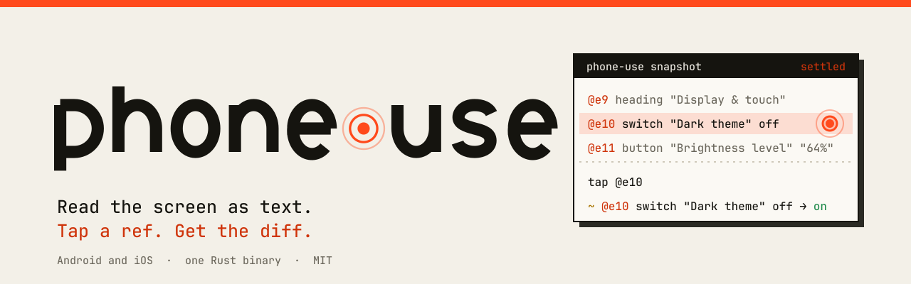
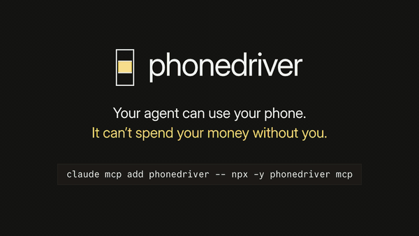
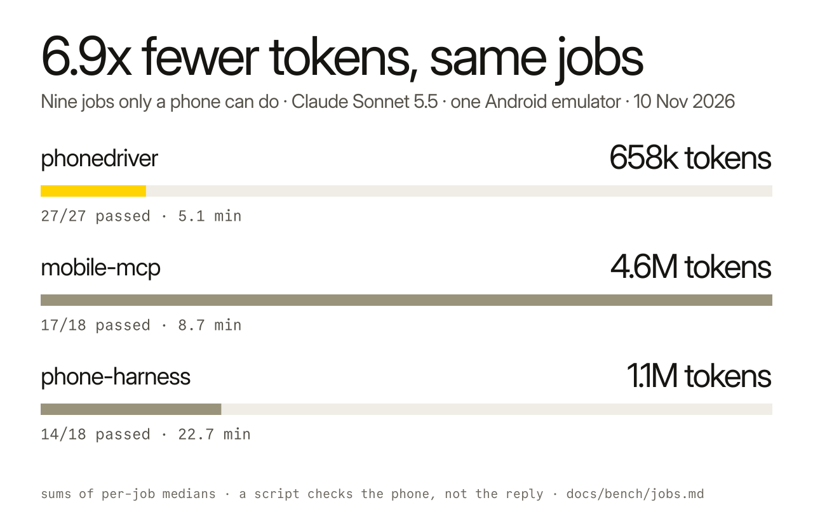
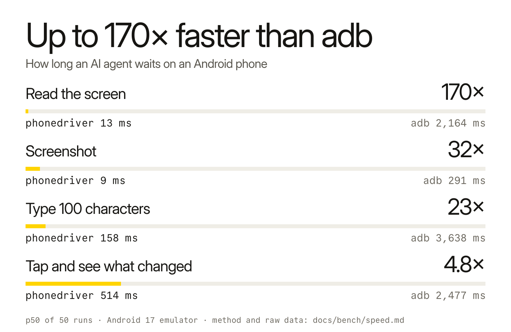
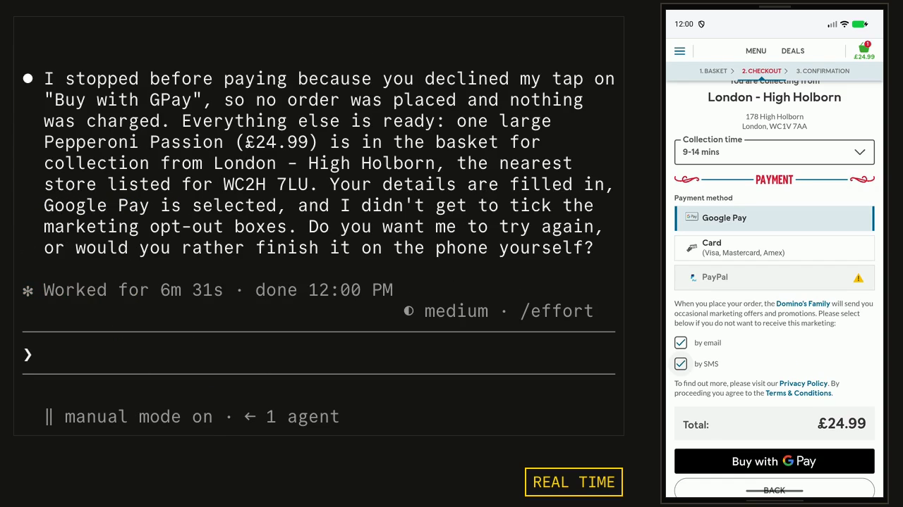

<p align="center"><picture><source media="(prefers-color-scheme: dark)" srcset=".github/assets/banner-dark.svg"></picture></p>

<h3 align="center">Give your AI agent a phone.</h3>

_Last updated: 2026-11-20_

<p align="center"><b>6.9x fewer tokens than mobile-mcp.</b></p>

<p align="center">
  <a href="LICENSE"></a>
  <a href="https://www.npmjs.com/package/phonedriver"></a>
  <a href="https://github.com/hridaya423/phonedriver/actions/workflows/ci.yml"></a>
  <a href="https://github.com/sponsors/hridaya423"></a>
</p>

<p align="center">
  <a href="https://phonedriver.dev">phonedriver.dev</a> · <a href="https://phonedriver.dev/docs/">Docs</a> · <a href="https://phonedriver.dev/compare/">Compare</a> · <a href="docs/reference.md">Reference</a> · <a href="https://phonedriver.dev/benchmarks/">Benchmarks</a> · <a href="https://github.com/hridaya423/phonedriver/releases">Releases</a>
</p>

<p align="center"><a href="README.md">English</a> · <a href="README.zh-CN.md">简体中文</a> · <a href="README.ja.md">日本語</a> · <a href="README.ko.md">한국어</a></p>

phonedriver gives an AI agent the controls of a phone, an Android phone or an iPhone, real or virtual. It reads the screen, taps a button, and reports what changed, and it asks you before it taps Pay. Use it through MCP with Claude Code, Codex or Cursor, or from the command line. The 6.9x is the token total on [nine phone jobs](#fewer-tokens).

Ask it to test your signup form. Change a setting buried three screens deep. Find the step where your app stops working.

<p align="center">
  
</p>

<p align="center"><sub>One real Claude Code session on an Android emulator, ordering on dominos.co.uk: 6.5 minutes at 15x, with the approval prompt at real speed. Nothing was ordered. <a href=".github/assets/demo.mp4">Full video (MP4)</a>.</sub></p>

## Start

```sh
npx -y phonedriver init
```

This adds phonedriver to the agents it finds on your machine: Claude Code, Codex, Cursor, VS Code and Gemini CLI. It then checks adb, Xcode and your devices and says what to fix. An agent that already has it is left alone; `--dry-run` shows what it would do.

<p>         </p>

Start an Android emulator or the iOS Simulator, or plug in an Android phone with USB debugging on. With nothing connected, the error names what phonedriver can start, and `phonedriver boot "iPhone 17"` starts it. Then give your agent a job that only a phone can do:

> Open my app and test signup. Try invalid inputs. Report each bug with steps to reproduce it.

> Order me a large pepperoni pizza from the Domino's nearest Leicester Square, for collection.

The second one is the demo above. phonedriver stops at Buy with GPay and asks you.

The first run downloads one binary for your machine (macOS, Linux or Windows) and caches it. `phonedriver doctor` checks the setup again at any time.

### Plugins

The plugin bundles the MCP server and the [skill](SKILL.md) that teaches your agent how to use it. Use the plugin or the MCP setup, not both, or the tools are listed twice.

**Claude Code**

```sh
claude plugin marketplace add hridaya423/phonedriver
claude plugin install phonedriver@phonedriver
```

**Codex**

```sh
codex plugin marketplace add hridaya423/phonedriver
codex plugin add phonedriver@phonedriver
```

**Cursor**

The [Cursor plugin](packaging/plugin) bundles the same server and skill. From a clone of this repository, install it locally and restart Cursor ([Cursor's local plugin guide](https://cursor.com/docs/plugins#test-plugins-locally)):

```sh
mkdir -p ~/.cursor/plugins/local
cp -R packaging/plugin ~/.cursor/plugins/local/phonedriver
```

<details>
<summary>Manual MCP setup, Homebrew and other clients</summary>

phonedriver is a standard MCP server over stdio, so any MCP client can run it. I test it with Claude Code.

```sh
claude mcp add phonedriver -- npx -y phonedriver mcp     # Claude Code
codex mcp add phonedriver -- npx -y phonedriver mcp      # Codex
code --add-mcp '{"name":"phonedriver","command":"npx","args":["-y","phonedriver","mcp"]}'   # VS Code
```

Or install the binary with Homebrew and register that:

```sh
brew install hridaya423/tap/phonedriver
claude mcp add phonedriver -- phonedriver mcp
```

<a href="https://cursor.com/en/install-mcp?name=phonedriver&config=eyJjb21tYW5kIjoibnB4IiwiYXJncyI6WyIteSIsInBob25lZHJpdmVyIiwibWNwIl19"></a> <a href="https://insiders.vscode.dev/redirect/mcp/install?name=phonedriver&config=%7B%22command%22%3A%22npx%22%2C%22args%22%3A%5B%22-y%22%2C%22phonedriver%22%2C%22mcp%22%5D%7D"></a>

Every other client takes the same entry in its MCP config file:

```json
{
  "mcpServers": {
    "phonedriver": { "command": "npx", "args": ["-y", "phonedriver", "mcp"] }
  }
}
```

With more than one device connected, add `"env": { "PHONEDRIVER_DEVICE": "android:emulator-5554" }`. `phonedriver devices` lists the ids.

The shell and PowerShell installers are in the [install guide](https://phonedriver.dev/docs/install/). A guide for each client: [Claude Code](https://phonedriver.dev/docs/claude-code/), [Codex](https://phonedriver.dev/docs/codex/), [VS Code](https://phonedriver.dev/docs/vs-code/), [Cursor, Gemini CLI, Zed and Cline](https://phonedriver.dev/docs/cursor-and-mcp-clients/).

</details>

## What the model sees

<p align="center"><picture><source media="(prefers-color-scheme: dark)" srcset=".github/assets/reads-dark.webp"></picture></p>

Each screen arrives as a short numbered list. This is the Settings app on an Android emulator:

```console
$ phonedriver snapshot
app com.android.settings (Settings)
@e1 button "Search Settings"
@e2 group scrollable↓
  @e3 button "Google" "Services & preferences"
  @e4 button "Network & internet" "Mobile, Wi‑Fi, hotspot"
  @e5 button "Connected devices" "Bluetooth, pairing"
  ...
  @e10 button "Display & touch" "Dark theme, font size, touch"
```

The model taps by number. After `tap @e10` the Display screen opens and the reply lists it, including `@e24 switch "Dark theme" off`. The next tap returns only what changed:

```console
$ phonedriver tap @e24
ok tapped @e24 "Dark theme"
~ @e23 button "Dark theme" "Will turn on when Bedtime starts" → "Will never turn off automatically"
~ @e24 switch "Dark theme" off → on
```

`+` marks a line that appeared, `-` one that left, `~` one that changed. phonedriver waits until the screen stops changing before it replies, so the model doesn't need to poll or guess how long a screen takes to load. It takes a screenshot only when it needs to see a picture.

On Android, phonedriver starts a small Java helper on the phone over adb. The helper reads the accessibility tree through UiAutomation and streams the screen as H.264 video, which is how phonedriver knows when the screen has stopped changing. On iOS, an XCTest runner does the same job; on the Simulator, taps go to its own touch input and the settle watches its screen as it is drawn. A daemon on your computer keeps the connection open and remembers which `@e` number is which element, so a tap still lands after a list has moved. The MCP server and the CLI are thin clients of that daemon.

## Fewer tokens

Tokens are what an agent's usage limit is spent on. I ran nine jobs that only a phone can do with Claude Sonnet 5.5 and three MCP servers: three times each with phonedriver, twice with the other two. The jobs included setting Chrome's search engine, cropping a photo, pinning and archiving Messages threads, finding the app that keeps the phone awake, and testing a sign-up flow for planted bugs. A script checked the phone's own data afterwards, not the model's report.

<p align="center"><picture><source media="(prefers-color-scheme: dark)" srcset=".github/assets/jobs-dark.svg"></picture></p>

This is my own test set. All three tools ran on the same Android emulator on 10 November 2026. Every run, the versions, the checks and what was thrown away are published in [docs/bench/jobs.md](docs/bench/jobs.md). If you maintain one of these tools and think I set it up wrong, open an issue and I will rerun it. Side by side: [phonedriver vs mobile-mcp](https://phonedriver.dev/compare/mobile-mcp/) and [phonedriver vs phone-harness](https://phonedriver.dev/compare/phone-harness/).

## Speed

<p align="center">
  <picture><source media="(prefers-color-scheme: dark)" srcset=".github/assets/hero-dark.svg"></picture>
</p>

Measured on 11 November 2026 with phonedriver 0.1.1 on an Android 17 emulator, median of 50 runs, against `adb shell uiautomator dump`, `screencap` and `input`. The difference comes from the helper process: it keeps the accessibility connection open, where adb starts a new process and writes XML each time. On a HONOR X8 phone (Android 13), reading the screen took 78.5 ms against 2,507 ms, and a screenshot took 16 ms against 1,006 ms. [Method and raw data.](docs/bench/speed.md) [phonedriver vs adb.](https://phonedriver.dev/compare/adb/)

On simulator-use's own iOS Simulator benchmark, phonedriver read the screen, tapped and signed in step by step faster than simulator-use, agent-device and Argent. simulator-use types faster because its keys hide the on-screen keyboard; phonedriver keeps the keyboard up and types the way it does on an iPhone. [The numbers.](https://phonedriver.dev/benchmarks/#simulator)

<p align="center">It’s called <b>simulator</b>-use. This is <b>phone</b>driver.</p>

## Keep a run that worked

Save an agent's session as a repeatable test:

```sh
phonedriver save signup.steps
phonedriver replay signup.steps
phonedriver replay signup.steps --screens screens/signup
```

Replay needs no model. It stops at the first step that misses and shows the screen, so the agent can do that one step. With `--screens`, the first replay keeps a screenshot after each step, and later replays stop at the first step whose screen shows different text. The status bar is left out. A step that typed a secret is saved with the name of an environment variable (`PHONEDRIVER_SECRET_1`), not its text, and a replay types what that variable holds, so a login replays in CI. `{{name}}` in a step is filled from `--var name=value`, and `{{run}}` is a new id for each replay.

The repository is also a GitHub Action that boots an emulator or a Simulator, installs your app and replays these files on every commit ([Saving and replaying a run](docs/reference.md#saving-and-replaying-a-run), [in CI](docs/reference.md#replaying-runs-in-github-actions)).

## What else it does

- Records an MP4 of the screen on Android and on the iOS Simulator, with a timed list of the actions done during it ([Recording the screen](docs/reference.md#recording-the-screen)).
- Says in text what changed between two screenshots, and lists the controls a screen reader can't name and tap targets that are too small ([Accessibility problems on a screen](docs/reference.md#accessibility-problems-on-a-screen)).
- On Android, an action during which the app crashed says so in its reply, with the exception and the line that threw it, and `logs` prints the app's last log lines. On Android 17, `setting` changes a system setting by key in one call ([Settings by key](docs/reference.md#settings-by-key)).
- Reads a web page whole in one call: `snapshot` with `page: true` returns the text of the page in Chrome, or in a debug build's web view, through the browser's own debugging socket ([Reading a web page](docs/reference.md#reading-a-web-page)).
- Reads a screen that gives no element list (a web view with accessibility off, a Flutter or game canvas) from its pixels, on macOS and Windows with the system's own text recognition and on Linux with Tesseract if it is installed. The text found can be tapped by name.
- `press fingerprint` touches an Android emulator's fingerprint sensor, and on an iOS Simulator the same key answers Face ID, so a test can pass or fail the prompt.
- One call can tap a whole path: `tap {"target":"More options","then":["Settings","Dark theme"]}`. Models tap one step at a time unless told otherwise, so give your agent the skill (`phonedriver skill` prints it), which tells it to send paths.

<details>
<summary>The 17 MCP tools</summary>

`devices`, `apps`, `snapshot`, `screenshot`, `tap`, `type`, `swipe`, `scroll`, `press`, `launch`, `wait`, `batch`, `clipboard`, `shell`, `setting`, `logs` and `replay`.

`snapshot`, `screenshot`, `wait`, `logs` and `network` are marked read-only, so a client can run them without a permission prompt. The `phonedriver` CLI has the same commands, for scripts and for agents that prefer a shell. A device you used from a terminal goes to your agent after 30 seconds idle. Every command and argument is in the [reference](docs/reference.md), and everything new in 0.1.7 is in the [changelog](CHANGELOG.md).

</details>

## Asking before it pays

When a tap lands on a button labeled Pay, Buy now, Buy with GPay, Place order, Start subscription, Transfer or Delete account, phonedriver holds the tap and asks you in Claude Code's own prompt. The model never sees that question and can't answer it. In a client that can't show such a prompt, the tap waits and the model has to ask you in chat.

<p align="center"></p>

You choose Allow, Allow for this session, or Decline. If you want an agent to run without asking, you can say so in its instructions, and it passes `autonomous: true`; you can also turn the check off with `PHONEDRIVER_GUARD=off`.

The check reads button labels in English, Spanish, Portuguese, French, German, Italian, Dutch, Japanese, Chinese (Simplified), Korean and Hindi. It does not catch a payment button that is only an icon, or one labeled in another language. By default it asks about payments and deleting an account. To be asked about more, set `PHONEDRIVER_ASK` to any of `send` (Send, Reply, Post, Share), `delete` (Delete, Remove, Clear all) and `install` (Install, Uninstall), for example `PHONEDRIVER_ASK=send,delete`. The prompt says which kind of tap it is.

The model can't type plain text into a password field or a one-time code field. It gets an error that tells it to use `secret`, which keeps the text out of logs and traces and shows it as `•••` if a later screen prints it. [How the guard decides.](https://phonedriver.dev/docs/approval-guard/)

## Devices

| Device | You need |
|---|---|
| Android emulator | adb |
| Android phone or tablet | adb and USB debugging |
| iOS Simulator | a Mac with Xcode |
| iPhone or iPad | a Mac with Xcode and an Apple Development certificate ([setup](docs/reference.md#iphone-or-ipad)) |
| iPhone or iPad from Windows | Apple Devices, Sideloadly and a free Apple ID ([below](#iphone-from-windows)) |

On Android there is no app to install. phonedriver pushes its helper over adb when it connects. On iOS it builds a small XCTest runner on your Mac. For a real iPhone, plug it in and run `phonedriver ios setup`. It reads the signing team from your certificate, checks the phone, and builds, installs and starts the runner, so there is no team ID to look up. A free Apple ID works; its signature lasts 7 days, and the next command after that signs the runner again by itself.

The cable can come off after setup. For an iPhone, run `phonedriver ios wifi on` and unplug it; it stays in `phonedriver devices` while it shares a Wi-Fi network with the Mac. For an Android phone, `phonedriver pair` or `phonedriver untether` does the same ([Android over Wi-Fi](docs/reference.md#android-over-wi-fi)). When the phone is far away, on a tunnel or a mobile network, phonedriver sends a smaller screen stream and compressed screen trees. On a link shaped to 3G, the median tap on an emulator took 1.4 s, down from 2.8 s.

On Android 13 and later, the agent can work on a hidden second screen, so your own screen stays yours. Set `PHONEDRIVER_DISPLAY=hidden` in the MCP config, or pass `--display hidden` to the CLI. It has been tested on an emulator and on a HONOR X8 (Android 13). The phone has to be unlocked: while it is locked the hidden screen shows the lock screen too, so phonedriver says the phone is locked and leaves it asleep. While the agent works, phonedriver keeps the phone's own screen on, so it does not lock under the agent; `phonedriver release` lets it sleep again. Several agents can share one phone the same way: give each a device id that ends in `+a`, `+b` and so on, and each works on a hidden screen of its own ([how](docs/reference.md#several-agents-on-one-android-phone)). Typing into an app's own fields leaves no trace on your screen. Typing into a web page shows the system's clipboard note, and your clipboard is put back after.

### iPhone from Windows

phonedriver drives an iPhone or iPad on iOS 17 or later from Windows, with no Mac. On a Mac, Xcode builds and signs phonedriver's XCTest runner. On Windows:

1. Install **Apple Devices** from the Microsoft Store (or iTunes). Its Apple Mobile Device Service is how Windows reaches the phone on the cable. Plug the phone in, unlock it and tap Trust.
2. Download `PhonedriverRunner.ipa` from the release of the phonedriver you run ([the latest](https://github.com/hridaya423/phonedriver/releases/latest/download/PhonedriverRunner.ipa); `phonedriver doctor` gives the link for yours). GitHub's macOS machines build it unsigned with each release. From 0.1.7 its checksum is beside it (`PhonedriverRunner.ipa.sha256`), and `gh attestation verify PhonedriverRunner.ipa --repo hridaya423/phonedriver` shows it came from the release workflow.
3. Install it with [Sideloadly](https://sideloadly.io), signed with your Apple ID. A free Apple ID's signature lasts 7 days, and Sideloadly can sign it again for you. phonedriver never sees your Apple ID. Then trust it on the phone: Settings > General > VPN & Device Management, your Apple ID under Developer App, Trust.
4. Turn on Settings > Privacy & Security > Developer Mode, restart the phone, and confirm Turn On after you unlock it. The disk image in step 6 does not mount while Developer Mode is off.
5. Install phonedriver with the Windows line under [Start](#start), or build it: `cargo build --release -p phonedriver --no-default-features` leaves out the Android helper, which needs the Android build tools.
6. Run `phonedriver ios setup --download-ddi`. It downloads Xcode 27.2's developer disk image once from [doronz88/DeveloperDiskImage](https://github.com/doronz88/DeveloperDiskImage) at a pinned commit, checks each file's SHA-256, and mounts it. Mounting asks Apple's signing server for your phone's ticket, as Xcode does. With files from a Mac, use `--ddi <folder>` instead. Then it finds the installed runner and starts it.
7. `claude mcp add phonedriver -- <path>\phonedriver.exe mcp`, then ask Claude to use the phone.
8. Optional, to unplug the cable: with the phone still plugged in and unlocked, run `phonedriver ios wifi on`. It also pairs this PC with the phone for Wi-Fi, the way Xcode's "Connect via network" does, and nothing shows on the phone. Unplug it. The phone stays in `phonedriver devices` while both are on the same network and the phone is awake. `phonedriver ios wifi off` undoes it and deletes the pairing record.

Tested on an iPhone 16e (iPhone17,5) on iOS 26.5 from Windows 11. On the cable: setup, `snapshot`, `screenshot`, `tap` and `press back` all work. Over Wi-Fi with the cable out: `doctor`, `snapshot` (about 0.35 s once the runner runs; the first one, which starts it, took 10.7 s), `screenshot`, `apps`, `launch`, `tap` and `press back` all work. With the phone locked, phonedriver kept reading the lock screen; in six minutes the phone dropped off the network twice, and the next command connected again in 10 to 19 s. If the phone stops answering in the middle of connecting, opening the Wi-Fi connection and checking its disk image each give up after 15 s and say to unlock it, and `phonedriver devices` keeps answering meanwhile. After the phone restarts, the next command mounts the image again from the downloaded files. Over Wi-Fi that remount has not been tried yet. `phonedriver doctor` shows what is missing, but it waits only 2 s for a phone on Wi-Fi to answer, so it can miss one that `phonedriver devices` finds. An iPhone on iOS 27 can also use the no-install CoreDevice tier with `PHONEDRIVER_IOS_TIER=coredevice` (cable only).

Wi-Fi from Windows uses a small addition to idevice, the library phonedriver talks to the phone with: starting the runner through the Wi-Fi tunnel. Until idevice has it, phonedriver builds against [a copy of idevice with it](https://github.com/hridaya423/idevice/tree/phonedriver-run-over-rsd) at a fixed commit, contributed by Coreho.

## Limits

- Tested on Android emulators (API 26 and 37), a HONOR X8 (Android 13), the iOS Simulator, an iPhone 13 Pro Max, an iPhone 14 Plus and an iPad Pro. Other Android phones use the same path. Bug reports from them are welcome.
- A tap alone takes 29 to 39 ms on an Android emulator and 450 to 530 ms on a real iPhone. The 514 ms in the Speed chart is a tap, the wait until the screen stops changing, and the list of what changed.
- The model can do anything on the phone you could do with your finger. For unattended runs, use an emulator or a spare phone. On a real test phone, `PHONEDRIVER_APP_SCOPE=com.example.app` keeps the agent's reads and taps to your app and refuses `shell`; it is not a sandbox, and [the docs](docs/reference.md#app-scope) list what it does not cover. On a shared adb server, `PHONEDRIVER_DENY_DEVICES` or a `~/.phonedriver/devices` file keeps phones that must never be driven out of reach: they are not listed, not probed by `doctor`, and never get the agent ([reference](docs/reference.md#devices-an-agent-must-not-touch)).
- phonedriver never enters a passcode, and on a real phone it can't pass Face ID or a fingerprint check. On a locked phone a command stops and says the device is locked. phonedriver keeps a phone awake while an agent is using it. Screens that block screenshots, as some banking apps do, come out black in a screenshot, though their text can still be read.

## FAQ

**How do I let Claude control my Android phone?** Run `claude mcp add phonedriver -- npx -y phonedriver mcp`, turn on USB debugging, and plug the phone in.

**Does it work with an iPhone?** Yes, from a Mac with Xcode, on the Simulator or on an iPhone or iPad. `phonedriver ios setup` signs the runner with your Apple developer team, and `phonedriver ios wifi on` lets you unplug the cable.

**Can I control an iPhone from Windows?** Yes, on the cable or over Wi-Fi: see [iPhone from Windows](#iphone-from-windows). The runner is built on GitHub's macOS machines and you sign it with Sideloadly.

**Why does an iPhone need a Mac, and why does the signing expire?** Apple lets a computer drive an iPhone only through its developer tools: a small test app (the runner) that Xcode builds and signs with your Apple ID. A free Apple ID's signature lasts 7 days and a paid developer account's a year; when it has run out, the next phonedriver command signs the runner again by itself, with the phone attached and unlocked. The Simulator needs no signing. phonedriver never enters a passcode and can't pass Face ID on a real phone, on purpose: unlock it yourself, and it stays awake while the agent works.

**Can my agent buy things with it?** Not without your answer, unless you have told it to run autonomously. See [Asking before it pays](#asking-before-it-pays).

**Can I use it at work?** Yes. It is AGPL-3.0: you can use it freely. If you change it and offer it to others as a network service, you must publish your changes.

More answers are in [the FAQ](https://phonedriver.dev/faq/).

## Source and license

phonedriver sends no telemetry. After the first download from GitHub, it connects only to your device (and, off a Mac, to Apple and once to GitHub for the iPhone developer disk image when you ask with `ios setup --download-ddi`), and a test runs the whole tool in a sandbox that blocks every other connection. Design notes: [architecture](docs/architecture.md), [protocol](docs/protocol.md), [decisions](docs/decisions.md).

AGPL-3.0-only. See [LICENSE](LICENSE). The Android helper includes files from scrcpy under Apache-2.0; see [NOTICE](NOTICE).

The binary decodes H.264 with OpenH264 built from source. Cisco's patent license covers only the binaries Cisco distributes, so this build carries no H.264 patent license.

phonedriver is free and open source. If it saves you or your team time, you can [sponsor development on GitHub](https://github.com/sponsors/hridaya423).
