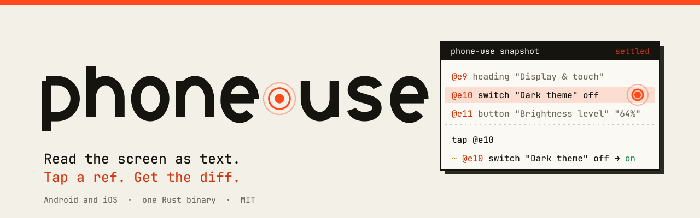
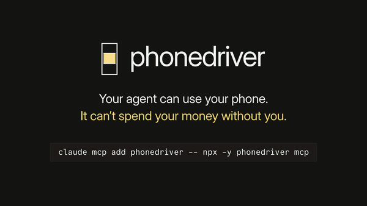
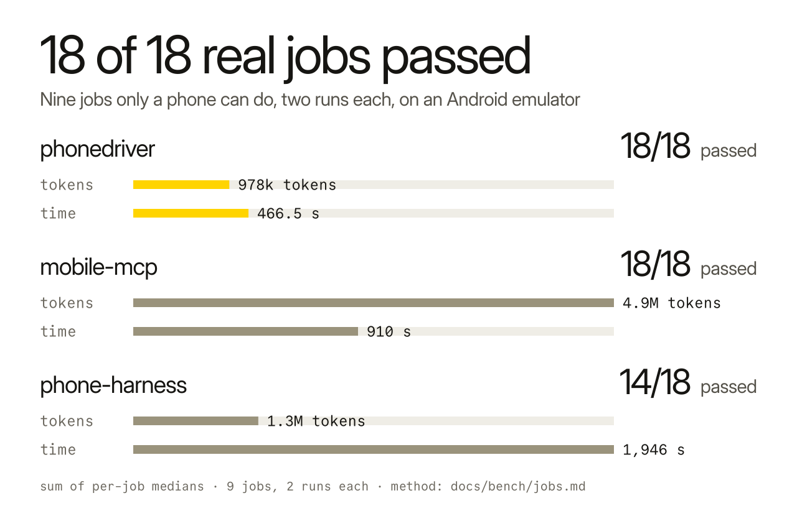
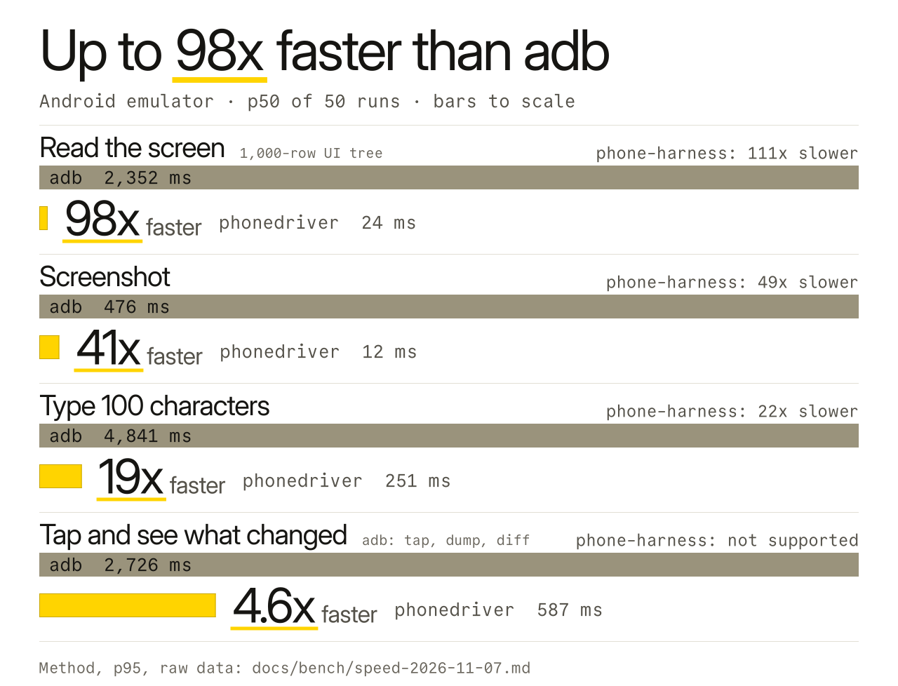
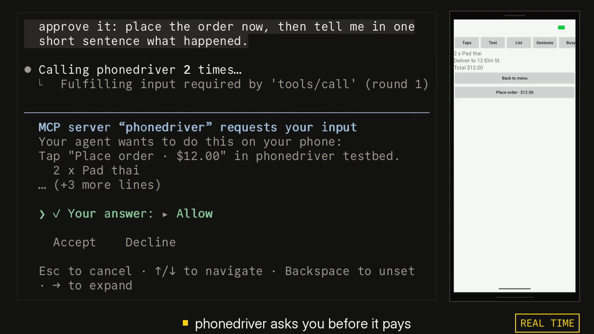

<p align="center"><picture><source media="(prefers-color-scheme: dark)" srcset=".github/assets/banner-dark.svg"></picture></p>

<h3 align="center">Give your AI agent a phone.</h3>

<p align="center"><b>6.9x fewer tokens than mobile-mcp.</b></p>

<p align="center">
  <a href="LICENSE"></a>
  <a href="https://www.npmjs.com/package/phonedriver"></a>
  <a href="https://github.com/hridaya423/phonedriver/actions/workflows/ci.yml"></a>
</p>

<p align="center">
  <a href="https://phonedriver.dev">phonedriver.dev</a> · <a href="docs/reference.md">Reference</a> · <a href="docs/bench/jobs.md">Benchmarks</a> · <a href="https://github.com/hridaya423/phonedriver/releases">Releases</a>
</p>

phonedriver lets Claude Code, Codex, Cursor or any MCP client use an Android phone or an iPhone. It reads the screen as text, and it asks you before it taps Pay. The 6.9x is the token total on [nine phone jobs](#fewer-tokens).

<p align="center">
  
</p>

<p align="center"><sub>One real Claude Code (Opus 5.5) session on an Android emulator, ordering on dominos.co.uk. The clip opens on the approval prompt, then shows the run from the start. The run took 6.5 minutes and is shown at 15x; the approval prompt plays at real speed. Nothing was ordered. <a href=".github/assets/demo.mp4">Full video (MP4)</a>.</sub></p>

## Start

```sh
claude mcp add phonedriver -- npx -y phonedriver mcp
```

Or install the binary with Homebrew and register that:

```sh
brew install hridaya423/tap/phonedriver
claude mcp add phonedriver -- phonedriver mcp
```

<a href="https://cursor.com/en/install-mcp?name=phonedriver&config=eyJjb21tYW5kIjoibnB4IiwiYXJncyI6WyIteSIsInBob25lZHJpdmVyIiwibWNwIl19"></a> <a href="https://insiders.vscode.dev/redirect/mcp/install?name=phonedriver&config=%7B%22command%22%3A%22npx%22%2C%22args%22%3A%5B%22-y%22%2C%22phonedriver%22%2C%22mcp%22%5D%7D"></a>

<p>         </p>

phonedriver is a standard MCP server over stdio, so any MCP client can run it. I test it with Claude Code. Setup for the others: [Other clients](#other-clients).

Start an Android emulator, plug in an Android phone with USB debugging on, or boot the iOS Simulator. Then give Claude a job that only a phone can do:

> Order me a large pepperoni pizza from the Domino's nearest Leicester Square, for collection.

> Open my app, sign up with a new account, and tell me every bug you find on the way. Give me steps to reproduce each one.

> Go through my app's onboarding in dark mode and in light mode, and show me every screen where the text is hard to read.

The first one is the demo above. phonedriver stops at Buy with GPay and asks you.

The first run downloads one binary for your machine (macOS, Linux or Windows) and caches it. `phonedriver doctor` checks adb, Xcode and each device and tells you what to fix. The shell and PowerShell installers and real iPhones: [docs/reference.md](docs/reference.md#install).

## Fewer tokens

Tokens are what an agent's usage limit is spent on. I ran nine jobs that only a phone can do, twice each, with Claude Sonnet 5.5 and three MCP servers. The jobs included setting Chrome's search engine, cropping a photo, pinning and archiving Messages threads, finding the app that keeps the phone awake, and testing a sign-up flow for planted bugs. A script checked the phone's own data afterwards, not the model's report.

<p align="center"><picture><source media="(prefers-color-scheme: dark)" srcset=".github/assets/jobs-dark.svg"></picture></p>

This is my own test set. All three tools ran on the same Android emulator on 10 November 2026. phone-harness used fewer tokens than phonedriver on two of the nine jobs. Every run, the versions, the checks and what was thrown away are published in [docs/bench/jobs.md](docs/bench/jobs.md). If you maintain one of these tools and think I set it up wrong, open an issue and I will rerun it.

## What the model sees

Each screen arrives as a short numbered list. This is the Settings app on an Android emulator:

```console
$ phonedriver snapshot
app com.android.settings (Settings) · keyboard hidden · settled in 0ms
@e1 button "Search Settings"
@e2 group scrollable↓
  @e3 button "Google" "Services & preferences"
  @e4 button "Network & internet" "Mobile, Wi‑Fi, hotspot"
  @e5 button "Connected devices" "Bluetooth, pairing"
  ...
  @e10 button "Display & touch" "Dark theme, font size, touch"
```

The model taps by number. phonedriver waits until the screen stops changing, then replies. After `tap @e10` the Display screen opens and the reply lists it, including `@e24 switch "Dark theme" off`. The next tap returns only what changed:

```console
$ phonedriver tap @e24
ok tapped @e24 "Dark theme" at 353,532 · settled in 2034ms
~ @e23 button "Dark theme" "Will turn on when Bedtime starts" → "Will never turn off automatically"
~ @e24 switch "Dark theme" off → on
```

`+` marks a line that appeared, `-` one that left, `~` one that changed. The model doesn't need to poll or guess how long a screen takes to load. It takes a screenshot only when it needs to see a picture.

## Speed

<p align="center">
  <picture><source media="(prefers-color-scheme: dark)" srcset=".github/assets/hero-dark.svg"></picture>
</p>

Measured on an Android 17 emulator, median of 50 runs, against `adb shell uiautomator dump`, `screencap` and `input`. The difference comes from a small helper process that phonedriver starts on the phone. It keeps the accessibility connection open, where adb starts a new process and writes XML each time. On a HONOR X8 phone (Android 13), reading the screen took 78.5 ms against 2,507 ms, and a screenshot took 16 ms against 1,006 ms. [Method and raw data.](docs/bench/speed.md)

## Asking before it pays

When a tap lands on a button labeled Pay, Buy now, Buy with GPay, Place order, Start subscription, Transfer or Delete account, phonedriver holds the tap and asks you in Claude Code's own prompt. The model never sees that question and can't answer it. In a client that can't show such a prompt, the tap waits and the model has to ask you in chat.

<p align="center"></p>

You choose Allow, Allow for this session, or Decline. If you want an agent to run without asking, you can say so in its instructions, and it passes `autonomous: true`; you can also turn the check off with `PHONEDRIVER_GUARD=off`.

The check reads button labels in English, Spanish, Portuguese, French, German, Italian, Dutch, Japanese, Chinese (Simplified), Korean and Hindi. It does not catch a payment button that is only an icon, or one labeled in another language. By default it asks about payments and deleting an account. To be asked about more, set `PHONEDRIVER_ASK` to any of `send` (Send, Reply, Post, Share), `delete` (Delete, Remove, Clear all) and `install` (Install, Uninstall), for example `PHONEDRIVER_ASK=send,delete`. The prompt says which kind of tap it is.

The model can't type plain text into a password field or a one-time code field. It gets an error that tells it to use `secret`, which keeps the text out of logs and traces.

## Works with

| Phone | You need |
|---|---|
| Android emulator | adb |
| Android phone or tablet | adb and USB debugging |
| iOS Simulator | a Mac with Xcode |
| iPhone or iPad | a Mac with Xcode and an Apple developer team ([setup](docs/reference.md#iphone-or-ipad)) |

On Android there is no app to install. phonedriver pushes its helper over adb when it connects. On iOS it builds a small XCTest runner on your Mac.

On Android 13 and later, the agent can work on a hidden second screen, so your own screen stays yours. Set `PHONEDRIVER_DISPLAY=hidden` in the MCP config, or pass `--display hidden` to the CLI. It has been tested on an emulator and on a HONOR X8 (Android 13). Typing into an app's own fields leaves no trace on your screen. Typing into a web page shows the system's clipboard note, and your clipboard is put back after.

The MCP server has 14 tools: `devices`, `apps`, `snapshot`, `screenshot`, `tap`, `type`, `swipe`, `scroll`, `press`, `launch`, `wait`, `batch`, `clipboard` and `shell`. The `phonedriver` CLI has the same commands, for scripts and for agents that prefer a shell.

## Limits

- Tested on Android emulators (API 26 and 37), a HONOR X8 (Android 13), the iOS Simulator, an iPhone 14 Plus and an iPad Pro. Other Android phones use the same path. Bug reports from them are welcome.
- A tap alone takes 70 to 120 ms on an Android emulator and 450 to 530 ms on a real iPhone. The 587 ms in the Speed chart is a tap, the wait until the screen stops changing, and the list of what changed.
- The model can do anything on the phone you could do with your finger. For unattended runs, use an emulator or a spare phone.
- phonedriver never enters a passcode and can't pass Face ID or a fingerprint check. Screens that block screenshots, as some banking apps do, come out black in a screenshot, though their text can still be read.

## Other clients

```sh
claude mcp add phonedriver -- npx -y phonedriver mcp     # Claude Code
codex mcp add phonedriver -- npx -y phonedriver mcp      # Codex
code --add-mcp '{"name":"phonedriver","command":"npx","args":["-y","phonedriver","mcp"]}'   # VS Code
```

Every other client takes the same entry in its MCP config file:

```json
{
  "mcpServers": {
    "phonedriver": { "command": "npx", "args": ["-y", "phonedriver", "mcp"] }
  }
}
```

With more than one device connected, add `"env": { "PHONEDRIVER_DEVICE": "android:emulator-5554" }`. `phonedriver devices` lists the ids.

## How it works

On Android, phonedriver starts a small Java helper on the phone over adb. The helper reads the accessibility tree through UiAutomation and streams the screen as H.264 video, which is how phonedriver knows when the screen has stopped changing. On iOS, an XCTest runner does the same job. A daemon on your computer keeps the connection open and remembers which `@e` number is which element, so a tap still lands after a list has moved. The MCP server and the CLI are thin clients of that daemon.

phonedriver sends no telemetry. After the first download from GitHub, it connects only to your device, and a test runs the whole tool in a sandbox that blocks every other connection. Design notes: [architecture](docs/architecture.md), [protocol](docs/protocol.md), [decisions](docs/decisions.md).

## FAQ

**How do I let Claude control my Android phone?** Run `claude mcp add phonedriver -- npx -y phonedriver mcp`, turn on USB debugging, and plug the phone in.

**Does it work with an iPhone?** Yes, from a Mac with Xcode, on the Simulator or on an iPhone or iPad signed with your Apple developer team.

**Can my agent buy things with it?** Not without your answer, unless you have told it to run autonomously. See [Asking before it pays](#asking-before-it-pays).

**Can I use it at work?** Yes. It is AGPL-3.0: you can use it freely. If you change it and offer it to others as a network service, you must publish your changes.

## License

AGPL-3.0-only. See [LICENSE](LICENSE). The Android helper includes files from scrcpy under Apache-2.0; see [NOTICE](NOTICE).

The binary decodes H.264 with OpenH264 built from source. Cisco's patent license covers only the binaries Cisco distributes, so this build carries no H.264 patent license.
