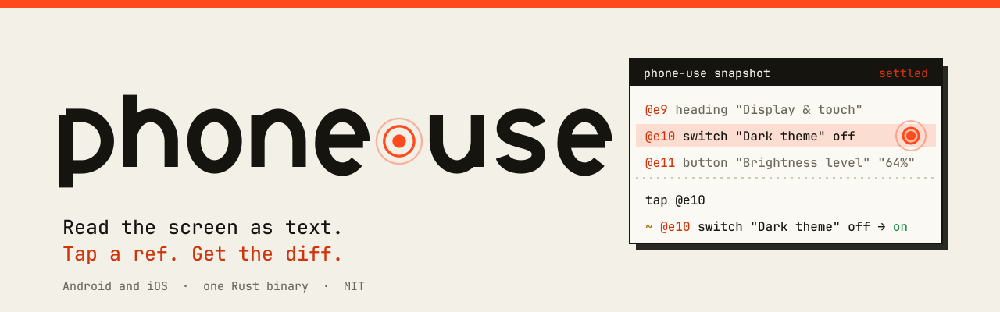
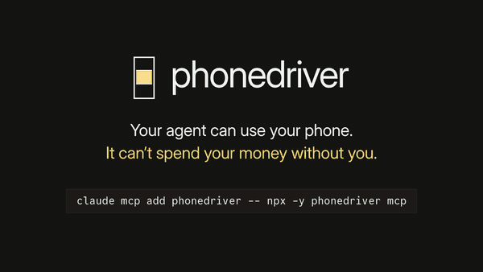
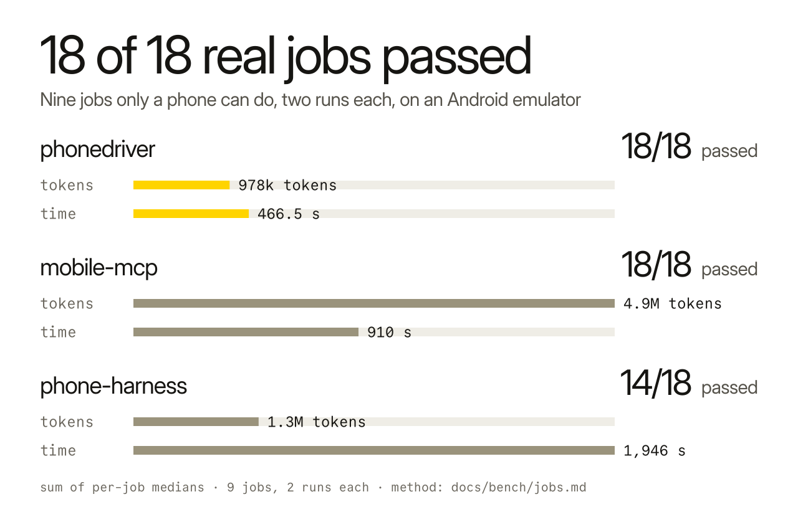
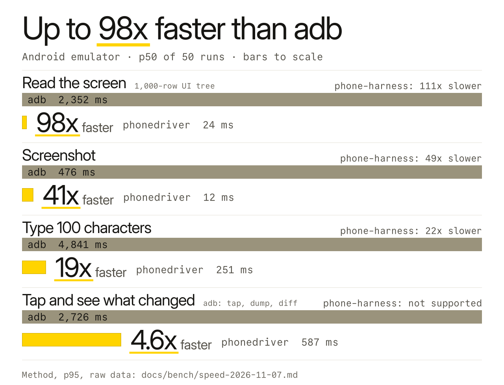
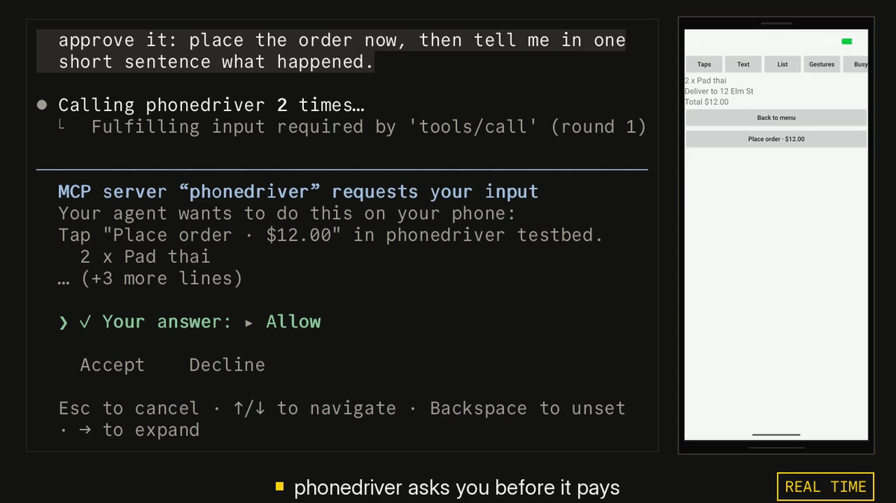

<p align="center"><picture><source media="(prefers-color-scheme: dark)" srcset=".github/assets/banner-dark.svg"></picture></p>

<h3 align="center">给你的 AI 智能体一部手机。</h3>

<p align="center"><b>同样的任务，mobile-mcp 的 token 用量是它的 6.9 倍。</b></p>

<p align="center">
  <a href="LICENSE"></a>
  <a href="https://www.npmjs.com/package/phonedriver"></a>
  <a href="https://github.com/hridaya423/phonedriver/actions/workflows/ci.yml"></a>
</p>

<p align="center">
  <a href="https://phonedriver.dev">phonedriver.dev</a> · <a href="docs/reference.md">Reference</a> · <a href="docs/bench/jobs.md">Benchmarks</a> · <a href="https://github.com/hridaya423/phonedriver/releases">Releases</a>
</p>

<p align="center"><a href="README.md">English</a> · <a href="README.zh-CN.md">简体中文</a></p>

> 本文档由机器翻译，内容以[英文 README](README.md) 为准。如有翻译错误，欢迎提 issue 或 PR。

phonedriver 让 Claude Code、Codex、Cursor 或任何 MCP 客户端都能使用 Android 手机或 iPhone。它把屏幕读成文本，并且在点击 Pay 之前先问你。6.9 倍是[九个手机任务](#更少的-token)的 token 总量之比。

<p align="center">
  
</p>

<p align="center"><sub>一次真实的 Claude Code（Opus 5.5）会话，在 Android 模拟器上于 dominos.co.uk 下单。视频开头是确认提示，随后从头回放整个过程。整个过程用了 6.5 分钟，以 15 倍速播放；确认提示按真实速度播放。没有下单。<a href=".github/assets/demo.mp4">完整视频（MP4）</a>。</sub></p>

## 开始

```sh
claude mcp add phonedriver -- npx -y phonedriver mcp
```

或者用 Homebrew 安装二进制文件，再注册它：

```sh
brew install hridaya423/tap/phonedriver
claude mcp add phonedriver -- phonedriver mcp
```

或者装成插件，这样会同时添加服务器和它的 [skill](SKILL.md)。插件和 `mcp add` 只用其中一种，否则工具会被列出两次。

```sh
claude plugin marketplace add hridaya423/phonedriver && claude plugin install phonedriver@phonedriver   # Claude Code
codex plugin marketplace add hridaya423/phonedriver && codex plugin add phonedriver@phonedriver         # Codex
```

<a href="https://cursor.com/en/install-mcp?name=phonedriver&config=eyJjb21tYW5kIjoibnB4IiwiYXJncyI6WyIteSIsInBob25lZHJpdmVyIiwibWNwIl19"></a> <a href="https://insiders.vscode.dev/redirect/mcp/install?name=phonedriver&config=%7B%22command%22%3A%22npx%22%2C%22args%22%3A%5B%22-y%22%2C%22phonedriver%22%2C%22mcp%22%5D%7D"></a>

<p>         </p>

phonedriver 是通过 stdio 通信的标准 MCP 服务器，所以任何 MCP 客户端都能运行它。我用 Claude Code 测试。其他客户端的设置见：[其他客户端](#其他客户端)。

启动一个 Android 模拟器，或者插上一部已开启 USB 调试的 Android 手机，或者启动 iOS 模拟器。然后给 Claude 一个只有手机才能完成的任务：

> Order me a large pepperoni pizza from the Domino's nearest Leicester Square, for collection.

> Open my app, sign up with a new account, and tell me every bug you find on the way. Give me steps to reproduce each one.

> Go through my app's onboarding in dark mode and in light mode, and show me every screen where the text is hard to read.

第一个就是上面的演示。phonedriver 会在 Buy with GPay 前停下，并询问你。

首次运行会为你的机器下载一个二进制文件（macOS、Linux 或 Windows）并缓存。`phonedriver doctor` 会检查 adb、Xcode 和每台设备，并告诉你该修复什么。shell 和 PowerShell 安装脚本以及真实 iPhone 的用法见：[docs/reference.md](docs/reference.md#install)。

## 更少的 token

token 是智能体用量上限所消耗的单位。我用 Claude Sonnet 5.5 和三个 MCP 服务器，把九个只有手机才能完成的任务各跑了两遍。这些任务包括设置 Chrome 的搜索引擎、裁剪照片、置顶并归档 Messages 会话、找出让手机保持唤醒的应用，以及测试注册流程里被预先植入的 bug。事后由脚本检查手机自身的数据，而不是模型的报告。

<p align="center"><picture><source media="(prefers-color-scheme: dark)" srcset=".github/assets/jobs-dark.svg"></picture></p>

这是我自己的测试集。三个工具都在同一个 Android 模拟器上于 2026 年 11 月 10 日运行。每一次运行、版本、检查方式以及被丢弃的数据，都公布在 [docs/bench/jobs.md](docs/bench/jobs.md)。如果你维护其中某个工具，并认为我配置错了，请提 issue，我会重新运行。

## 模型看到什么

每个屏幕都以一份简短的编号列表送达。这是 Android 模拟器上的“设置”应用：

```console
$ phonedriver snapshot
app com.android.settings (Settings) · keyboard hidden · settled in 0ms
@e1 button "Search Settings"
@e2 group scrollable↓
  @e3 button "Google" "Services & preferences"
  @e4 button "Network & internet" "Mobile, Wi‑Fi, hotspot"
  @e5 button "Connected devices" "Bluetooth, pairing"
  ...
  @e10 button "Display & touch" "Dark theme, font size, touch"
```

模型按编号点击。phonedriver 会等到屏幕不再变化才回复。执行 `tap @e10` 后，Display 界面打开，回复会列出它，其中包括 `@e24 switch "Dark theme" off`。下一次点击只返回发生变化的部分：

```console
$ phonedriver tap @e24
ok tapped @e24 "Dark theme" at 353,532 · settled in 2034ms
~ @e23 button "Dark theme" "Will turn on when Bedtime starts" → "Will never turn off automatically"
~ @e24 switch "Dark theme" off → on
```

`+` 表示新出现的一行，`-` 表示消失的一行，`~` 表示发生变化的一行。模型不需要轮询，也不用猜一个界面要多久才加载完。只有需要看图时，它才会截图。

## 速度

<p align="center">
  <picture><source media="(prefers-color-scheme: dark)" srcset=".github/assets/hero-dark.svg"></picture>
</p>

测量于 2026 年 11 月 11 日，使用 phonedriver 0.1.1，在 Android 17 模拟器上取 50 次运行的中位数，对比 `adb shell uiautomator dump`、`screencap` 和 `input`。差距来自 phonedriver 在手机上启动的一个小型辅助进程。它一直保持无障碍连接，而 adb 每次都要启动新进程并写出 XML。在一部 HONOR X8 手机（Android 13）上，读取屏幕用了 78.5 ms，对比 2,507 ms；截图用了 16 ms，对比 1,006 ms。[方法和原始数据。](docs/bench/speed.md)

## 付款前先询问

当点击落在标签为 Pay、Buy now、Buy with GPay、Place order、Start subscription、Transfer 或 Delete account 的按钮上时，phonedriver 会拦住这次点击，并在 Claude Code 自带的提示中询问你。模型看不到这个问题，也无法回答。在无法显示这类提示的客户端中，这次点击会等待，由模型在聊天中向你询问。

<p align="center"></p>

你可以选择 Allow、Allow for this session 或 Decline。如果你想让智能体不经询问直接运行，可以在它的指令中说明，它会传入 `autonomous: true`；你也可以用 `PHONEDRIVER_GUARD=off` 关闭这项检查。

这项检查能读取英语、西班牙语、葡萄牙语、法语、德语、意大利语、荷兰语、日语、中文（简体）、韩语和印地语的按钮标签。它检测不到只有图标的付款按钮，也检测不到用其他语言标注的按钮。默认情况下，它会询问付款和删除账户。若想对更多操作进行询问，可以把 `PHONEDRIVER_ASK` 设为 `send`（Send、Reply、Post、Share）、`delete`（Delete、Remove、Clear all）和 `install`（Install、Uninstall）中的任意几项，例如 `PHONEDRIVER_ASK=send,delete`。提示会说明这次点击属于哪一类。

模型不能向密码字段或一次性验证码字段输入明文。它会收到一条错误，提示它改用 `secret`，这样文本不会进入日志和跟踪记录。

## 支持的设备

| 手机 | 你需要 |
|---|---|
| Android 模拟器 | adb |
| Android 手机或平板 | adb 和 USB 调试 |
| iOS 模拟器 | 装有 Xcode 的 Mac |
| iPhone 或 iPad | 装有 Xcode 的 Mac 和 Apple Development 证书（[设置](docs/reference.md#iphone-or-ipad)） |

在 Android 上不需要安装任何应用。phonedriver 连接时会通过 adb 推送它的辅助程序。在 iOS 上，它会在你的 Mac 上构建一个小型 XCTest runner。对于真实的 iPhone，插上手机并运行 `phonedriver ios setup`。它会从你的证书读取签名团队，检查手机，然后构建、安装并启动 runner，所以不用去查团队 ID。

设置完成后可以拔掉数据线。对 iPhone，运行 `phonedriver ios wifi on` 然后拔线；只要它和 Mac 在同一个 Wi-Fi 网络中，就会一直出现在 `phonedriver devices` 里。对 Android 手机，用 `phonedriver pair` 或 `phonedriver untether` 也能做到（[Android over Wi-Fi](docs/reference.md#android-over-wi-fi)）。当手机离得很远，比如走隧道或移动网络时，phonedriver 会发送更小的屏幕流和压缩过的屏幕树。在限速到 3G 的链路上，模拟器上的点击中位耗时是 1.4 s，原先是 2.8 s。

在 Android 13 及更高版本上，智能体可以在一个隐藏的第二屏幕上工作，所以你自己的屏幕仍归你使用。在 MCP 配置中设置 `PHONEDRIVER_DISPLAY=hidden`，或者给 CLI 传 `--display hidden`。已在模拟器和一部 HONOR X8（Android 13）上测试过。向应用自己的输入框输入文字，不会在你的屏幕上留下痕迹。向网页输入文字时，系统会显示剪贴板提示，之后你的剪贴板会被还原。

MCP 服务器有 14 个工具：`devices`、`apps`、`snapshot`、`screenshot`、`tap`、`type`、`swipe`、`scroll`、`press`、`launch`、`wait`、`batch`、`clipboard` 和 `shell`。`snapshot`、`screenshot` 和 `wait` 被标记为只读，所以客户端可以不经权限提示就运行它们。`phonedriver` CLI 有同样的命令，供脚本和更喜欢用 shell 的智能体使用。你在终端里用过的设备，空闲 30 秒后会交给你的智能体。

一次调用就能点击一整条路径：`tap {"target":"More options","then":["Settings","Dark theme"]}`。除非另有说明，模型每次只点一步，所以请把 skill 交给你的智能体（`phonedriver skill` 会打印它），它会告诉智能体发送路径。

## 限制

- 已在 Android 模拟器（API 26 和 37）、一部 HONOR X8（Android 13）、iOS 模拟器、一部 iPhone 13 Pro Max、一部 iPhone 14 Plus 和一台 iPad Pro 上测试。其他 Android 手机走的是同一条路径。欢迎提交它们的 bug 报告。
- 单独一次点击在 Android 模拟器上耗时 29 到 39 ms，在真实 iPhone 上耗时 450 到 530 ms。“速度”图表中的 514 ms 包括一次点击、等待屏幕停止变化，以及列出发生了什么变化。
- 凡是你能用手指在手机上做的事，模型都能做。对于无人值守的运行，请使用模拟器或备用手机。
- phonedriver 从不输入锁屏密码，也无法通过 Face ID 或指纹验证。手机锁定时，命令会停止并提示设备已锁定。在 `main` 上，phonedriver 会在智能体使用 iPhone 时让它保持唤醒；在 0.1.3 中，长任务开始前请把“自动锁定”设为“永不”。禁止截图的界面（部分银行应用就是这样）在截图中是黑的，不过其中的文字仍然可以读取。

## 其他客户端

```sh
claude mcp add phonedriver -- npx -y phonedriver mcp     # Claude Code
codex mcp add phonedriver -- npx -y phonedriver mcp      # Codex
code --add-mcp '{"name":"phonedriver","command":"npx","args":["-y","phonedriver","mcp"]}'   # VS Code
```

其他所有客户端都在它们的 MCP 配置文件中使用同样的条目：

```json
{
  "mcpServers": {
    "phonedriver": { "command": "npx", "args": ["-y", "phonedriver", "mcp"] }
  }
}
```

连接了多台设备时，加上 `"env": { "PHONEDRIVER_DEVICE": "android:emulator-5554" }`。`phonedriver devices` 会列出各个 id。

## 工作原理

在 Android 上，phonedriver 通过 adb 在手机上启动一个小型 Java 辅助程序。它通过 UiAutomation 读取无障碍树，并把屏幕作为 H.264 视频流发送出来，phonedriver 正是靠这个知道屏幕何时停止变化。在 iOS 上，由一个 XCTest runner 完成同样的工作。你电脑上的守护进程保持连接打开，并记住每个 `@e` 编号对应哪个元素，所以即使列表滚动过，点击仍能落在正确的位置。MCP 服务器和 CLI 都是这个守护进程的轻量客户端。

phonedriver 不发送任何遥测数据。首次从 GitHub 下载之后，它只连接你的设备，并且有一项测试会在沙盒中运行整个工具，沙盒会阻断其他所有连接。设计说明：[architecture](docs/architecture.md)、[protocol](docs/protocol.md)、[decisions](docs/decisions.md)。

## 常见问题

**如何让 Claude 控制我的 Android 手机？** 运行 `claude mcp add phonedriver -- npx -y phonedriver mcp`，打开 USB 调试，然后插上手机。

**它支持 iPhone 吗？** 支持，需要装有 Xcode 的 Mac，可以用模拟器，也可以用 iPhone 或 iPad。`phonedriver ios setup` 用你的 Apple 开发者团队给 runner 签名，`phonedriver ios wifi on` 让你可以拔掉数据线。

**我的智能体能用它买东西吗？** 没有你的回答不行，除非你已经告诉它自主运行。见[付款前先询问](#付款前先询问)。

**我能在工作中使用吗？** 可以。它采用 AGPL-3.0：你可以自由使用。如果你修改了它，并把它作为网络服务提供给他人，就必须公开你的修改。

## 许可证

AGPL-3.0-only。见 [LICENSE](LICENSE)。Android 辅助程序包含来自 scrcpy 的文件，采用 Apache-2.0；见 [NOTICE](NOTICE)。

二进制文件使用从源码构建的 OpenH264 解码 H.264。Cisco 的专利许可只覆盖 Cisco 自己分发的二进制文件，所以这个构建不带 H.264 专利许可。
