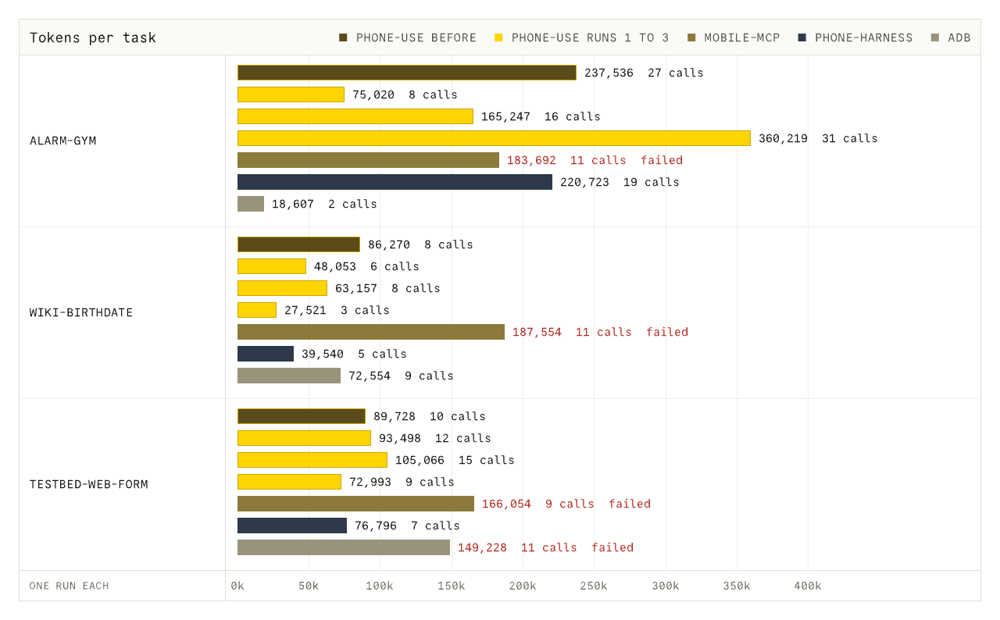

# Token benchmark: four phone-control harnesses

One run per harness per task, `claude -p` with `claude-sonnet-5-5` on the Claude subscription (`ANTHROPIC_API_KEY` unset, asserted before every run). The numbers are single samples: they show what happened, not rates.

## Method

- Runner: `bench/agent-eval/run-harness.sh <harness> <task> <out-dir>`; tasks and checks in `bench/agent-eval/tasks.yaml`. Each run resets device state, runs `claude -p` from an empty directory with `--strict-mcp-config --disable-slash-commands --setting-sources "" --no-session-persistence --output-format stream-json --verbose --max-turns 40`, then checks success from device state (alarm database, testbed event log) or from the final answer text, never from the agent's claim, then cleans up.
- Tools per harness: phone-use `mcp__phone-use__*` only (`--tools ""`); mobile-mcp `mcp__mobile-mcp__*` only; phone-harness `Bash(phone-harness:*)` only; raw adb `Bash(adb:*)` only.
- Same task prompt for all harnesses. The system-prompt appendix names the target device; phone-harness and adb get one line on how to call the tool; mobile-mcp is told its device id may be `Pixel_Tablet_API_37`.
- Tokens: input + output + cache creation + cache read from the stream-json `result` usage (the M3 definition). Cost is the reported `total_cost_usd`, informational only (subscription).
- Device: Pixel_Tablet_API_37 (`emulator-5558`, 2560x1600, headless, `-gpu swangle_indirect`) on win-pc, through `ssh -L 5038:127.0.0.1:5037` and `ADB_SERVER_SOCKET=tcp:127.0.0.1:5038`. For mobile-mcp, whose helper needs `adb forward` and failed against the remote server (error 10013), the final runs use a local adb server (`adb -P 5099 connect 127.0.0.1:5559` over an ssh tunnel). Other emulators were not used.
- Versions: phone-use built from main (`cargo build --release`); mobile-mcp 1.0.16; phone-harness 0.3.3 (telemetry off, isolated venv); adb as installed.
- Tasks: `alarm-gym` (Clock: 7:30 AM alarm labelled "Gym", weekdays only; checked in the Clock app's alarm database), `wiki-birthdate` (Chrome: en.wikipedia.org, search Grace Hopper, answer the birth date; checked against "December 9, 1906"), `testbed-web-form` (testbed web form with Ada Lovelace, agreement ticked, submit; checked in the testbed event log). `dark-theme` and `alarm-0730` were dropped from the table because one shell command does them.

## Results

| Task | Harness | OK | Total | In | Out | Cache create | Cache read | Calls | Wall s |
|---|---|---|---|---|---|---|---|---|---|
| alarm-gym | phone-use before | yes | 237,536 | 36 | 1,793 | 13,930 | 221,777 | 27 | 57 |
| alarm-gym | phone-use run 1 | yes | 75,020 | 18 | 789 | 7,665 | 66,548 | 8 | 28 |
| alarm-gym | phone-use run 2 | yes | 165,247 | 32 | 1,183 | 10,651 | 153,381 | 16 | 58 |
| alarm-gym | phone-use run 3 | yes | 360,219 | 50 | 2,092 | 19,548 | 338,529 | 31 | 68 |
| alarm-gym | mobile-mcp | NO | 183,692 | 22 | 1,613 | 6,829 | 175,228 | 11 | 83 |
| alarm-gym | phone-harness | yes | 220,723 | 40 | 2,382 | 12,919 | 205,382 | 19 | 190 |
| alarm-gym | adb | yes | 18,607 | 6 | 626 | 4,919 | 13,056 | 2 | 21 |
| wiki-birthdate | phone-use before | yes | 86,270 | 18 | 828 | 6,161 | 79,263 | 8 | 92 |
| wiki-birthdate | phone-use run 1 | yes | 48,053 | 14 | 375 | 5,516 | 42,148 | 6 | 47 |
| wiki-birthdate | phone-use run 2 | yes | 63,157 | 18 | 475 | 5,706 | 56,958 | 8 | 59 |
| wiki-birthdate | phone-use run 3 | yes | 27,521 | 8 | 201 | 5,118 | 22,194 | 3 | 53 |
| wiki-birthdate | mobile-mcp | NO | 187,554 | 22 | 1,532 | 7,089 | 178,911 | 11 | 92 |
| wiki-birthdate | phone-harness | yes | 39,540 | 12 | 543 | 6,492 | 32,493 | 5 | 94 |
| wiki-birthdate | adb | yes | 72,554 | 20 | 1,553 | 6,717 | 64,264 | 9 | 94 |
| testbed-web-form | phone-use before | yes | 89,728 | 18 | 672 | 7,103 | 81,935 | 10 | 41 |
| testbed-web-form | phone-use run 1 | yes | 93,498 | 22 | 785 | 8,641 | 84,050 | 12 | 32 |
| testbed-web-form | phone-use run 2 | yes | 105,066 | 22 | 1,087 | 10,853 | 93,104 | 15 | 36 |
| testbed-web-form | phone-use run 3 | yes | 72,993 | 18 | 652 | 7,834 | 64,489 | 9 | 30 |
| testbed-web-form | mobile-mcp | NO | 166,054 | 20 | 1,344 | 6,234 | 158,456 | 9 | 94 |
| testbed-web-form | phone-harness | yes | 76,796 | 16 | 947 | 11,400 | 64,433 | 7 | 82 |
| testbed-web-form | adb | NO | 149,228 | 24 | 2,028 | 13,243 | 133,933 | 11 | 48 |

| Harness | Passed | Total tokens | Calls | Wall s | Reported cost USD |
|---|---|---|---|---|---|
| phone-use before | 3/3 | 413,534 | 45 | 190 | 0.181 |
| phone-use run 1 | 3/3 | 216,571 | 26 | 107 | 0.127 |
| phone-use run 2 | 3/3 | 333,470 | 39 | 153 | 0.167 |
| phone-use run 3 | 3/3 | 460,733 | 43 | 151 | 0.203 |
| mobile-mcp | 0/3 | 537,300 | 31 | 269 | 0.177 |
| phone-harness | 3/3 | 337,059 | 31 | 366 | 0.193 |
| adb | 2/3 | 240,389 | 22 | 163 | 0.163 |

Raw stream-json logs, results and discarded runs: `/private/tmp/claude-501/-Users-hridyaagrawal-Honey-phone-use/4cb1136a-fafb-4ccd-b147-78d0e944ff9f/scratchpad/tokens/` (session scratch, not in the repo). `docs/bench/tokens.json` holds the table's data.

Earlier runs on the dropped tasks, for the record (same setup): `dark-theme` phone-use 63,380 tokens / 7 calls ok, phone-harness 60,060 / 8 ok, adb 10,658 / 1 ok (`cmd uimode night yes`); `alarm-0730` phone-use 77,149 / 8 ok, adb 37,002 / 5 ok, phone-harness failed (`uiautomator dump` killed).

## After the token fixes (phone-use runs 1 to 3)

`docs/audits/token-audit.md` has the analysis. Three more phone-use runs of the same three tasks, same device and runner (`bench/agent-eval/run-harness.sh`, `claude-sonnet-5-5` passed explicitly, `ANTHROPIC_API_KEY` unset), each after a batch of fixes. phone-harness and the other rows are the original runs, not rerun.

- Run 1: main with the dogfood fixes (fbafaae) plus: reply re-reads the tree until it stops changing and while a page loads; `launch`/`open` wait for another app to come to the front; `tools/list` hides `device` and unused arguments and has shorter descriptions.
- Run 2: plus a cold web view is waited for up to 10 s.
- Run 3: plus a reply that only removes lines waits up to 2 s for the new window; a typed text or a tap that leaves a page loading always gets the stable tree; the "Content copied" overlay our own paste raises is pruned.

What was measured, not guessed:

- **Fixed overhead per turn** (one-word `claude -p`, benchmark flags): tools plus instructions 4,204 tokens at c2297a1 (10,987 characters of `tools/list`), 2,768 now (5,107 characters). First-turn context 7,421 to 5,985; phone-harness's is about 4,850 in the benchmark prompt.
- **Totals**: 216,571 (run 1), 333,470 (run 2), 460,733 (run 3) against 413,534 before and phone-harness's 337,059; 3 of 3 each time; wall time 107, 153 and 151 s against phone-harness's 366 s.
- **The spread is larger than the change.** The same code and task gave `alarm-gym` 75,020, 165,247 and 360,219 tokens (8, 16 and 31 calls). Run 1 finished `alarm-gym` with one `shell am start -a android.intent.action.SET_ALARM` call (the shell-first instructions; the checker accepts it), runs 2 and 3 drove the Clock UI. In runs 2 and 3 the first `tap` on Add alarm after a cold Clock launch (`not settled after 5.5 s`) did nothing (`no change after 507ms`), and the agent spent 5 to 8 calls and 3 to 4 screenshots finding that out. `wiki-birthdate` ran 48,053, 63,157 and 27,521; `testbed-web-form` 93,498, 105,066 and 72,993.
- Per task, the median of the three runs against phone-harness: `alarm-gym` 165,247 against 220,723; `wiki-birthdate` 48,053 against 39,540; `testbed-web-form` 93,498 against 76,796. phone-use is ahead on the longest task and behind on the two short ones, where the 1,100 tokens a turn it still carries more than phone-harness (5,985 against about 4,850) are most of the total.
- Not shown by three samples: whether the fixes beat phone-harness on total tokens. Two of the three totals do; the third does not.

## Caveats

- **mobile-mcp failed every run (0 of 3, and 0 of 6 counting the dropped tasks) for an environment reason, not a measured capability.** Screenshots and app launch worked; taps and UI listing failed with "device server did not start within 5s" (and, against the remote adb server, an `adb forward` bind error 10013). Its token totals are the cost of an agent retrying a broken tool, so they should not be compared with the others. A run on a local emulator or phone is needed.
- **raw adb on `alarm-gym` used the `SET_ALARM` intent** (`am start -a android.intent.action.SET_ALARM ...`) and finished in 2 calls. That is a shell shortcut for this task; the task does not fully need a UI harness. `testbed-web-form` for adb failed: the form is a WebView with no accessibility nodes, and the agent was not allowed to use anything but `adb`.
- One sample each; tablet layout (2560x1600), not a phone; the emulator was shared with other jobs on win-pc, so wall times are noisy.
- phone-use's original `alarm-gym` run took 27 calls and the most tokens of the group (the Clock weekday chips and label dialog); phone-harness took 19. The original phone-use runs had no `shell` tool; runs 1 to 3 have it.
- Run order and leftovers mattered: mobile-mcp's on-device server (`com.mobilenext.mobilecli.DeviceServer`) holds the accessibility bridge and made other harnesses fail (`another UiAutomation client`, `uiautomator dump ... Killed`). Those first `testbed-web-form` runs were discarded and rerun after killing it; the table shows the reruns. The run script now kills it after each run.
- Prompt overhead differs per harness (MCP tool schemas vs Bash only), which is part of what the totals measure.
