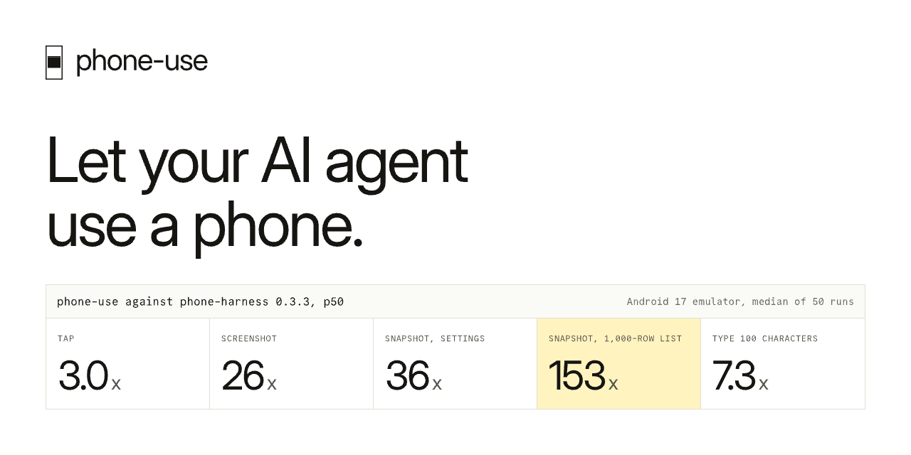
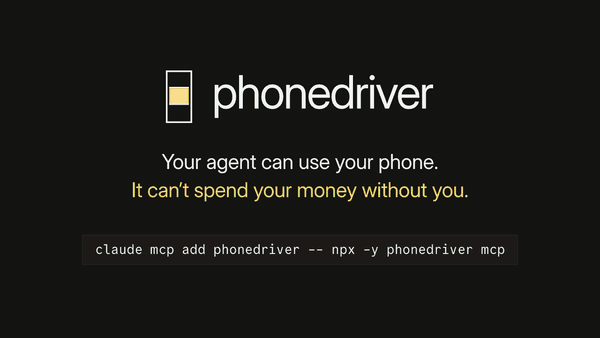

<p align="center"></p>

# phonedriver

**phonedriver is an open-source MCP server and CLI that lets AI agents like Claude Code, Codex and Cursor see and control Android and iOS phones.** It shows a screen as numbered text, every tap, type or swipe returns only the lines that changed, and it asks you before it taps Pay.

- **6.9x fewer tokens than mobile-mcp** on nine real phone jobs, with 27 of 27 runs passed.
- **170x faster than adb** at reading a screen (12.7 ms against 2,163.7 ms).
- **Asks before it pays.** A tap on Pay, Buy now or Place order is held until you approve it.
- **No telemetry.** No app to install on an Android phone.

[Website](https://phonedriver.dev) · [Docs](https://phonedriver.dev/docs/) · [Benchmarks](https://phonedriver.dev/benchmarks/) · [GitHub](https://github.com/hridaya423/phonedriver)

<p align="center"></p>

## Install

Add it to your agent as an MCP server. Nothing else to install: `npx` downloads one binary on first run.

```sh
claude mcp add phonedriver -- npx -y phonedriver mcp     # Claude Code
codex mcp add phonedriver -- npx -y phonedriver mcp      # Codex
```

Cursor, VS Code, Windsurf or any other MCP client: a stdio server with command `npx` and args `["-y", "phonedriver", "mcp"]`.

```json
{ "mcpServers": { "phonedriver": { "command": "npx", "args": ["-y", "phonedriver", "mcp"] } } }
```

Then start an Android emulator, plug in an Android phone with USB debugging on, or boot the iOS Simulator, and check the setup:

```sh
npx -y phonedriver doctor     # says ok, warn or fail for adb, Xcode and each device, with the fix
npx -y phonedriver devices
```

Now give your agent a job that only a phone can do:

> Open my app, sign up with a new account, and tell me every bug you find on the way.

## What the model sees

A screen arrives as a short numbered list, not a screenshot and not XML:

```console
$ npx -y phonedriver snapshot
app com.android.settings (Settings) · keyboard hidden · settled in 0ms
@e1 button "Search Settings"
@e2 group scrollable↓
  @e3 button "Google" "Services & preferences"
  @e4 button "Network & internet" "Mobile, Wi‑Fi, hotspot"
  @e10 button "Display & touch" "Dark theme, font size, touch"
```

The model taps by number. phonedriver waits until the screen stops changing and replies with only what changed:

```console
$ npx -y phonedriver tap @e24
ok tapped @e24 "Dark theme" · settled in 410ms
~ @e24 switch "Dark theme" off → on
```

## Benchmarks

Nine jobs that only a phone can do, Claude Sonnet 5.5, one Android emulator, 10 November 2026. A script checked the phone's own data afterwards.

| Tool | Runs passed | Tokens | Time |
|---|---|---|---|
| **phonedriver** | **27 of 27** | **657,542** | **5.1 min** |
| phone-harness 0.3.3 | 14 of 18 | 1,127,495 | 22.7 min |
| mobile-mcp 1.0.16 | 17 of 18 | 4,567,200 | 8.7 min |

Speed against plain adb, median of 50 runs on an Android 17 emulator, phonedriver 0.1.1, 11 November 2026:

| Operation | phonedriver | adb | Faster |
|---|---|---|---|
| Read a 1,000-row screen | 12.7 ms | 2,163.7 ms | 170x |
| Read the Settings screen | 51.0 ms | 2,215.7 ms | 43x |
| Screenshot | 9.1 ms | 291.2 ms | 32x |
| Type 100 characters | 158.3 ms | 3,638.4 ms | 23x |
| Tap, then see what changed | 514.0 ms | 2,477.2 ms | 4.8x |

Method, raw samples and every run: [phonedriver.dev/benchmarks](https://phonedriver.dev/benchmarks/). Comparisons: [vs mobile-mcp](https://phonedriver.dev/compare/mobile-mcp/), [vs phone-harness](https://phonedriver.dev/compare/phone-harness/), [vs adb](https://phonedriver.dev/compare/adb/).

## Works with

| Device | You need |
|---|---|
| Android emulator | adb |
| Android phone or tablet | adb and USB debugging |
| iOS Simulator | a Mac with Xcode |
| iPhone or iPad | a Mac with Xcode and an Apple developer team |

Clients: Claude Code, Codex, Cursor, VS Code and any MCP client that starts a stdio server. An agent with only a shell can run the same commands as a CLI.

## Tools

Fourteen tools, the same as MCP tools and as CLI commands: `devices`, `apps`, `snapshot`, `screenshot`, `tap`, `type`, `swipe`, `scroll`, `press`, `launch`, `wait`, `batch`, `clipboard`, `shell`.

## Safety

- A tap on a button such as Pay, Buy now, Place order, Transfer or Delete account is held until the human approves it, through the MCP client or with CLI exit code 5. [How the approval guard works and its limits](https://phonedriver.dev/docs/approval-guard/).
- Text for a password or a one-time code goes through `type` with `secret` and never reaches logs, traces or replies.
- phonedriver sends no telemetry. A test runs the CLI, the daemon and the MCP server in a sandbox that kills the process on any connection that is not local.

## About this package

This package is a launcher. On first run it downloads the `phonedriver` binary for your platform from [GitHub Releases](https://github.com/hridaya423/phonedriver/releases), checks its SHA-256 against the `.sha256` file published beside it, caches it, and runs it. Later runs start the cached binary with no network. The launcher contacts GitHub only for that download, once per version and platform.

The binary is cached under `~/Library/Caches/phonedriver/npm` (macOS), `$XDG_CACHE_HOME` or `~/.cache/phonedriver/npm` (Linux), or `%LOCALAPPDATA%\phonedriver\npm` (Windows).

Platforms: macOS arm64 and x64, Linux x64 and arm64 (glibc), Windows x64. Needs Node 18 or later and `tar` (with xz support on macOS and Linux; Windows 10 and later ships it). Homebrew: `brew install hridaya423/tap/phonedriver`.

## Links

[Docs](https://phonedriver.dev/docs/) · [Install guide](https://phonedriver.dev/docs/install/) · [Changelog](https://phonedriver.dev/changelog/) · [Issues](https://github.com/hridaya423/phonedriver/issues) · License: [AGPL-3.0-only](https://github.com/hridaya423/phonedriver/blob/main/LICENSE)
